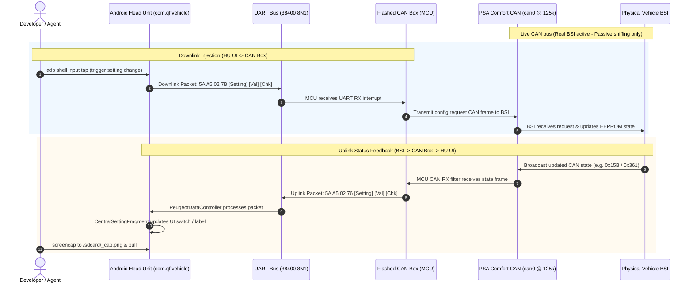

# Live Hardware CAN Box Debugging: Real BSI, SLCAN & ADB

This skill provides an end-to-end diagnostic and troubleshooting workflow when testing custom-flashed OpenCanbox firmware (STM32/NUC131) connected simultaneously to:
1. **Physical Vehicle CAN Bus (`can0`):** With a live, active BSI (125 kbps PSA Comfort CAN). **Do not inject unsolicited frames on active BSI IDs to avoid bus collisions.**
2. **Android Head Unit (`com.qf.vehicle`):** Connected via physical UART serial (38400 8N1) and monitored/controlled over ADB (WiFi `192.168.1.33:9876` or USB).

---

## 1. System Topology & Communication Flow



---

## 2. Prerequisites & Interface Bring-Up

### Step 1: Bind SLCAN (`can0`) at 125 kbps
PSA Comfort CAN operates at **125 kbps** (`-s4` in `slcand`):

```bash
# Check if can0 is already UP
ip link show can0

# If down or missing, attach SLCAN adapter (adjust /dev/ttyUSB0 if needed):
slcand -o -c -s4 /dev/ttyUSB0 can0
ip link set up can0 txqueuelen 1000

# Confirm traffic is flowing from physical BSI:
candump -tz can0 -n 10
```

### Step 2: Establish ADB Connection to Head Unit
```bash
# Connect over WiFi (standard port 9876 or 5555):
adb connect 192.168.1.33:9876

# Verify connection:
adb devices

# Quick check that com.qf.vehicle is running:
adb -s 192.168.1.33:9876 shell pidof com.qf.vehicle
```

---

## 3. Passive CAN Listening & Frame Extraction (`can0`)

> [!CAUTION]
> **Collision Warning:** The CAN bus has a real, active BSI attached. **Never send unsolicited periodic CAN frames** on IDs already driven by the BSI (e.g. `0x15B`, `0x260`, `0x361`, `0x036`, `0x0E6`). Doing so causes CAN error frames, bus off states, or erratic vehicle ECU behavior. Use passive capture and diffing.

### 3.1 Targeted Candump with ID Masking
Filter only the IDs relevant to vehicle settings and body electronics:

| CAN ID | Subsystem / Description | Rate / Trigger |
| :--- | :--- | :--- |
| `0x15B` | Vehicle Personalization / Settings Status (Follow-Me-Home, DRL, Auto-Lock) | Periodic / On change |
| `0x260` | Lighting Status & Stalk Positions (Sidelights, Low Beam, High Beam) | ~100 ms |
| `0x361` | Door, Boot, Bonnet Status & Remote Key Fob Lock/Unlock | Event / Periodic |
| `0x21F` | Steering Wheel Stalk Commands (Vol, Source, Seek, Esc, Menu) | Event |
| `0x165` | RD4 Radio Power, Volume, Tuner Band & Source | ~100 ms |

```bash
# Monitor only Settings (0x15B), Lights (0x260), and Doors (0x361):
candump -tz can0,15B:7FF,260:7FF,361:7FF
```

### 3.2 Extracting CAN Frame Deltas (Baseline vs. Action)
When you toggle a setting in the car or on the HU and need to see exactly which CAN byte changed:

```bash
# 1. Capture 3 seconds of baseline traffic
candump -t z can0,15B:7FF,361:7FF -T 3000 > /tmp/can_baseline.log

# 2. Trigger the action (e.g. toggle setting via HU or car button)
# 3. Capture 3 seconds of action traffic
candump -t z can0,15B:7FF,361:7FF -T 3000 > /tmp/can_action.log

# 4. Compare unique payloads:
sort -u -k3 /tmp/can_baseline.log
sort -u -k3 /tmp/can_action.log
```

Or run the built-in diff tool:
```bash
python3 tools/diff_canbox_frames.py --can-interface can0 --filter 15B,361
```

---

## 4. Log Head Unit Behavior via ADB Logcat

Monitor the exact interaction between the Android CAN service and the vehicle UI.

### 4.1 Focused Logcat Filter
Run logcat scoped to the critical CAN bus and Settings tags:

```bash
adb -s 192.168.1.33:9876 logcat -v time -s \
    PeugeotAlert:V \
    CanbusWarning:V \
    PeugeotDataController:V \
    VehicleService:V \
    UartDataTransmit:V \
    CentralSettingFragment:V \
    DataParserUtil:V
```

### 4.2 Real-Time UART Uplink & Downlink Sniffing
To observe the raw `5A A5 ...` frames transmitted across the serial link between HU and CAN box:

```bash
adb -s 192.168.1.33:9876 logcat -v time | grep --line-buffered -E "CANBOX_UART_TX|HU_UART_TX|handleVehicleData|writeACK2CanBox|writeData"
```

---

## 5. Inject Hiworld Commands into HU via ADB

When testing whether the **Android UI correctly responds to CAN box status packets**, inject raw Hiworld frames directly into `PeugeotDataController` via `CanbusAlertDebugReceiver`:

```bash
adb -s 192.168.1.33:9876 shell am broadcast \
    -a com.canbus.action.INJECT_CAN_PACKET \
    -p com.qf.vehicle \
    --es data "<HEX_FRAME>"
```

### Reference Packet Cheat Sheet (Settings & Vehicle Status)

#### 1. Vehicle Settings Confirmation (`0x76`)
Frame format: `5A A5 [LEN] 76 [SETTING_ID] [VAL] [CHECKSUM]`

* **Follow-Me-Home Delay (Setting `0x06`):**
  - Disable (0s): `5AA5027606007E`
  - 15 seconds: `5AA5027606017F`
  - 30 seconds: `5AA50276060280`
  - 60 seconds: `5AA50276060381`

* **Daytime Running Lights / DRL (Setting `0x05`):**
  - OFF: `5AA5027605007D`
  - ON: `5AA5027605017E`

* **Door Auto-Lock When Driving (Setting `0x0C`):**
  - OFF: `5AA502760C0084`
  - ON: `5AA502760C0185`

* **Rear Wiper in Reverse (Setting `0x04`):**
  - OFF: `5AA5027604007C`
  - ON: `5AA5027604017D`

#### 2. Other Key Subsystem Frames
* **Warning / Alert Journal (`0x42`):**
  - Engine Oil Temp High: `5AA5054201000100018F`
  - Clear / Empty Alert List: `5AA50242000043`
* **Radio Tuner Status (`0x84`):**
  - FM1 98.50 MHz, Preset 1: `5AA50E8401000000010003DE00000000006F`
* **CD Deck Status (`0x97`):**
  - Track 1, Playing: `5AA50B970100000300000100010000A7`

---

## 6. Inject Downlink Data to CAN Box (via HU Remote Control)

Because the CAN bus has a real BSI attached, the safest way to stimulate the custom CAN box firmware is to **trigger authentic downlink UART requests from the Android Head Unit**.

When a user taps an option in `com.qf.vehicle`, the app generates and writes the standard Hiworld downlink frame (`5A A5 02 7B ...`) to the CAN box UART RX pin.

### 6.1 Open Vehicle Settings UI
Launch `CentralSettingFragment`:
```bash
adb -s 192.168.1.33:9876 shell am start \
    -n com.qf.vehicle/.fragments.FragmentContainerActivity \
    --es fragmentclass com.qf.vehicle.fragments.CentralSettingFragment
```

### 6.2 Screen Tap Recipes (1280x720 Display)

#### Scenario A: Change Follow-Me-Home Headlight Delay
```bash
# 1. Switch to "Lighting / Vehicle" Tab (Left side menu)
adb -s 192.168.1.33:9876 shell input tap 150 282

# 2. Tap "With me goHome time" row (Opens popup dialog)
adb -s 192.168.1.33:9876 shell input tap 400 187

# 3. Select delay option inside popup:
# - Tap 30 seconds:
adb -s 192.168.1.33:9876 shell input tap 1080 282
# - OR Tap 60 seconds (Dispatches 5A A5 02 7B 06 02 84 down to CAN box):
adb -s 192.168.1.33:9876 shell input tap 1080 377
# - OR Tap 120 seconds:
adb -s 192.168.1.33:9876 shell input tap 1080 472
```

#### Scenario B: Toggle Daytime Running Lights (DRL)
```bash
# 1. Switch to "Lighting" Tab
adb -s 192.168.1.33:9876 shell input tap 150 282

# 2. Toggle "Day Time Light" switch on right edge:
adb -s 192.168.1.33:9876 shell input tap 1215 282
# (Dispatches 5A A5 02 7B 05 01 82 for ON, or 5A A5 02 7B 05 00 81 for OFF)
```

#### Scenario C: Toggle Door Auto-Lock When Driving
```bash
# 1. Switch to "Door / Window" Tab
adb -s 192.168.1.33:9876 shell input tap 150 377

# 2. Toggle "Door lock automatically" switch:
adb -s 192.168.1.33:9876 shell input tap 1215 285
# (Dispatches 5A A5 02 7B 0C 01 89 for ON, or 5A A5 02 7B 0C 00 88 for OFF)
```

### 6.3 Media & Audio App Launching
```bash
# Launch Factory RD4 Tuner UI:
adb -s 192.168.1.33:9876 shell am start -n com.qf.vehicle/com.qf.vehicle.activities.OriginalTuner

# Launch Factory CD Player UI:
adb -s 192.168.1.33:9876 shell am start -n com.qf.vehicle/com.qf.vehicle.activities.OriginalCD

# Send Media Keys:
adb -s 192.168.1.33:9876 shell input keyevent 85   # Play / Pause
adb -s 192.168.1.33:9876 shell input keyevent 87   # Next Track
adb -s 192.168.1.33:9876 shell input keyevent 88   # Prev Track
```

---

## 7. Verify UI Status & Data

### 7.1 Fast Screenshot Rule (< 3s Popups)
> [!IMPORTANT]
> Over WiFi ADB, direct streaming (`adb exec-out screencap -p`) takes ~2.6 seconds. Transient popups (such as the 2.5s volume or alert HUD cards) will dismiss before the capture completes.
> **Always screencap locally to `/sdcard/` first (~100 ms) and then pull:**

```bash
adb -s 192.168.1.33:9876 shell screencap -p /sdcard/_cap.png && \
adb -s 192.168.1.33:9876 pull /sdcard/_cap.png /tmp/screen_verify.png
```

### 7.2 Inspect Top Resumed Activity
```bash
adb -s 192.168.1.33:9876 shell dumpsys activity top | grep -E "ACTIVITY|ResumedActivity"
```

### 7.3 Cache Invalidation for Settings UI
`CentralSettingFragment` reads setting visibility from `/data/data/com.qf.vehicle/shared_prefs/centralstate_enable_db.xml`. If firmware changes or vehicle model profile changes are not reflected in the UI list:

```bash
adb -s 192.168.1.33:9876 shell "am force-stop com.qf.vehicle && rm -f /data/data/com.qf.vehicle/shared_prefs/centralstate_enable_db.xml"
```

---

## 8. Complete End-to-End Troubleshooting Walkthrough

Use this standard checklist when investigating why a vehicle setting (e.g. Follow-Me-Home delay) is not applying:

1. **Step 1: Verify CAN Bus Baseline**
   ```bash
   candump -tz can0,15B:7FF -n 3
   ```
2. **Step 2: Trigger UI Tap via ADB**
   ```bash
   adb -s 192.168.1.33:9876 shell input tap 1080 377
   ```
3. **Step 3: Check Downlink UART in Logcat**
   Verify `[HU_UART_TX]` or `writeData` emitted `5A A5 02 7B 06 02 84`.
   * *If missing:* Android model binding mismatch (check `PeugeotConstant.smali` / `PeugeotDataParser.smali`).
4. **Step 4: Check CAN Box MCU Reaction**
   Check if the flashed CAN box converts `0x7B 06 02` into a physical CAN message.
5. **Step 5: Check BSI Feedback on CAN**
   Monitor `candump -tz can0,15B:7FF` to observe if the physical BSI updates byte 1/2 of its status frame.
6. **Step 6: Check Uplink UART to HU**
   Verify `[CANBOX_UART_TX]` transmits `5A A5 02 76 06 02 80`.
7. **Step 7: Capture Screenshot & Verify UI State**
   ```bash
   adb -s 192.168.1.33:9876 shell screencap -p /sdcard/_cap.png && adb pull /sdcard/_cap.png /tmp/result.png
   ```

