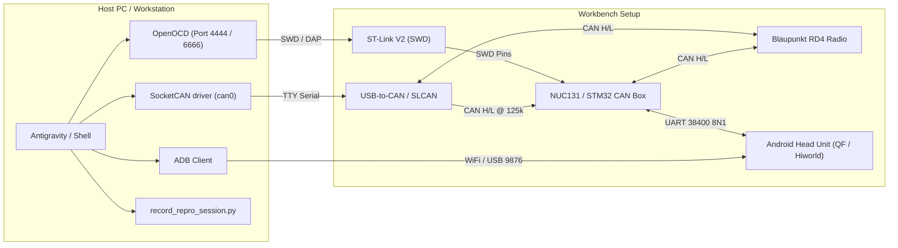

# Workbench Hardware Debug: ST-Link, SLCAN & ADB

This skill guides the agent and user through end-to-end hardware debugging, firmware deployment, and live multi-stream signal analysis on the vehicle/workbench test bench.

It simultaneously coordinates:
1. **ST-Link V2 / OpenOCD:** SWD debugging, register inspection, and FMC flash programming for Nuvoton NUC131 / STM32 CAN boxes.
2. **slcan / SocketCAN (`can0`):** Real-time PSA CAN2004 bus capture @ 125 kbps (`0x165` RD4 audio, `0x131` CD deck, `0x21F` stalk, `0x5E0` crash diagnostics).
3. **ADB (Android Head Unit):** Serial UART packet logging (`[CANBOX_UART_TX]`, `[HU_UART_TX]`), audio route managers (`com.qf.vehicle`), and UI control.

---

## 1. Hardware Topology



---

## 2. Prerequisites & Interface Bring-Up

### Step 1: Bring Up SLCAN (`can0`)
The Peugeot 407 Comfort CAN bus operates at **125 kbps** (`-s4` in slcand):

```bash
# Check if can0 already exists and is UP
ip link show can0

# If can0 is down or not present, bind SLCAN (adjust /dev/ttyUSB0 as needed):
slcand -o -c -s4 /dev/ttyUSB0 can0
ip link set up can0 txqueuelen 1000

# Verify active CAN bus traffic:
candump -tz can0
```

### Step 2: Connect ADB to Head Unit
The Android Head Unit typically exposes wireless ADB on port `9876` or standard `5555`:

```bash
# Verify connection
adb devices

# If disconnected, connect via IP:
adb connect 192.168.1.33:9876

# Confirm logcat access:
adb -s 192.168.1.33:9876 shell getprop ro.build.version.release
```

### Step 3: Launch OpenOCD for NUC131 / ST-Link
OpenOCD provides GDB (port 3333), Telnet (port 4444), and TCL (port 6666) interfaces:

```bash
# Check if OpenOCD is already running:
pgrep -fl openocd

# Start OpenOCD in the background if not active:
openocd -f openocd_nuc131.cfg &
```

---

## 3. Firmware Flashing & Resetting (NUC131 via ST-Link)

> [!IMPORTANT]
> The Nuvoton NUC131 chip ID (`0x11413102`) is unrecognized by stock OpenOCD `flash write_image`.
> Always use the repo's dedicated FMC hardware flasher `tools/nuc131_flasher.py`.
> Note: `tools/nuc131_flasher.py` automatically clears the boot token and executes `reset run` over TCL RPC upon flash verification. A manual socket/telnet reset is NOT required.

### Build Firmware Silently (`-s`)
```bash
~/.platformio/penv/bin/pio run -s -e raise_nuc131
```

### One-Shot Flash Application Binary (`0x00002000`)
Auto-spawns OpenOCD in the background (if not already running) and flashes the application:
```bash
pgrep -x openocd >/dev/null || (openocd -f openocd_nuc131.cfg -d0 > /tmp/openocd.log 2>&1 & sleep 0.5) && python3 tools/nuc131_flasher.py .pio/build/raise_nuc131/program.bin 0x2000
```

### Flash Bootloader Binary (`0x00000000`)
```bash
pgrep -x openocd >/dev/null || (openocd -f openocd_nuc131.cfg -d0 > /tmp/openocd.log 2>&1 & sleep 0.5) && python3 tools/nuc131_flasher.py .pio/build/nuc131_bootloader/program.bin 0x0000
```

### Targeted Live Verification One-Liners
Avoid broad dumping of logcat or raw CAN dumps:
```bash
# Verify live UART frames pushed to Android Head Unit:
adb -s 192.168.1.33:9876 logcat -d -t 150 | grep -E "readdata.*5a a5.*(76|79|15b)" | tail -n 10

# Verify live CAN frames (e.g. 0x15B / 0x260):
timeout 2 candump can0 | grep -E "15B|260"
```

---

## 4. Multi-Stream Live Recording (`tools/record_repro_session.py`)

To diagnose tricky timing issues, source switching glitches, or resets, use the correlated multi-stream recorder:

```bash
./tools/record_repro_session.py --can can0 --adb 192.168.1.33:9876
```

### What It Records in Real Time:
* **Microsecond CAN Frames:**
  - `0x165` (RD4 audio source, volume, power, mute status)
  - `0x131` (CD mechanism deck status: spinup `01`, standby `81`)
  - `0x21F` (Virtual COM2000 stalk pulse commands)
  - `0x162` (CDC changer emulator heartbeat)
  - `0x5E0` (Blaupunkt internal watchdog reset diagnostic frames)
* **UART Uplink & Downlink:**
  - `[CANBOX_UART_TX]`: Serial frames sent from CAN box to HU (`0x84`, `0x85`, `0x97`, `0x93`, `0x41`, `0x12`)
  - `[HU_UART_TX]`: Downlink requests sent from HU to CAN box (`0xAD` audio routing, `0x24` car type, `0xA1` radio control)
* **Android System Events:**
  - `PsaAudioRouteManager` state transitions
  - Audio focus requests, active package changes, media app lifecycles

Output files produced per session:
- `repro_session_<YYYY-MM-DD_HH-MM-SS>.log`: Unified chronological timestamped trace.
- `repro_can_<YYYY-MM-DD_HH-MM-SS>.log`: Raw candump format.
- `repro_adb_<YYYY-MM-DD_HH-MM-SS>.log`: Raw Android logcat.

---

## 5. Head Unit Remote Control (ADB Cheat Sheet)

Trigger UI actions or inspect vehicle apps on the Android Head Unit directly:

### Audio & Source Navigation
```bash
# Open Factory Radio UI
adb -s 192.168.1.33:9876 shell am start -n com.qf.vehicle/com.qf.vehicle.activities.OriginalTuner

# Open CD UI
adb -s 192.168.1.33:9876 shell am start -n com.qf.vehicle/com.qf.vehicle.activities.OriginalCD

# Open Car Settings / Trip UI
adb -s 192.168.1.33:9876 shell am start -n com.qf.vehicle/com.qf.vehicle.activities.CarSettingActivity
```

### Media Playback Emulation
```bash
# Play / Pause toggle
adb -s 192.168.1.33:9876 shell input keyevent 85

# Next track
adb -s 192.168.1.33:9876 shell input keyevent 87

# Previous track
adb -s 192.168.1.33:9876 shell input keyevent 88
```

---

## 6. Common Issues & Fast Triage

| Symptom | Probable Cause | Fast Fix |
| :--- | :--- | :--- |
| **OpenOCD: `auto_probe failed` / `Device ID: 0x11413102`** | Stock OpenOCD does not recognize NUC131 device ID. | Do **not** use `program` or `flash write_image`. Use `python3 tools/nuc131_flasher.py <bin> <addr>`. |
| **ST-Link: `libusb_open failed` / Target not halting** | ST-Link in bad state or openocd hung. | `pkill -9 openocd`, re-plug ST-Link USB, run `openocd -f openocd_nuc131.cfg &`. |
| **`can0: No such device`** | SLCAN adapter unplugged or `slcand` died. | Run `slcand -o -c -s4 /dev/ttyUSB0 can0 && ip link set up can0`. |
| **ADB: `device offline` or connection refused** | HU dropped WiFi or changed IP. | Ping HU, restart wireless adb on HU, run `adb kill-server && adb connect <HU_IP>:9876`. |
| **RD4 resets when CD spins up (`5E0#20 1E`)** | Transient current surge on bench power supply. | Normal hardware behavior; OpenCanbox absorbs reboot frames (`00 00 00 00`) and suppresses `0x84 FF`. Check bench 12V rail if persistent. |

