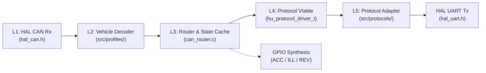

# OpenCanbox Core

**Portable, deterministic C99 firmware for CAN-to-Android automotive protocol translation and reverse engineering.**


OpenCanbox Core is a portable, zero-heap C99 firmware framework built to bridge automotive CAN bus networks with aftermarket Android head units across Linux, STM32, and ESP32 targets.


**Current Focus:** Re-implementing the Hiworld protocol to deploy custom code onto a spare Raise RZ-PSA15 canbox, introducing support for:
* Dual-zone climate control
* TPMS (Tire Pressure Monitoring)
* RD4 Tuner UI interface
* Audio routing from the head unit into the RD4
* RD4 sound configuration and volume control

OpenCanbox Core translates vehicle CAN bus frames into bidirectional UART packets for Android head units (Hiworld, Raise, Bagoo) and synthesizes physical GPIO signals (`ACC`, `ILL`, `REVERSE`).

* **Strict C99 & Zero Heap:** Compiles under `-std=c99 -Wall -Wextra -Werror` with zero dynamic memory allocation (`malloc`/`free` prohibited) and lock-free power-of-two SPSC ring buffers.
* **Hardware-Agnostic Core:** Decoders (`src/profiles/`), router (`src/core/`), and protocol adapters (`src/protocols/`) are isolated from MCU headers via `include/hal/*.h`.
* **Verified CAN2004 Ground Truth:** Implements verified signal mappings (e.g., Peugeot 407 PSA CAN2004 @ 125 kbps) with safe endian helpers (`read_be16`, `read_le16`) and strict `dlc` bounds checking.
* **Bandwidth-Aware Throttling:** State-caching delta filter and rate limiter preserve >85% idle margin on 38,400 baud UART links.

---

## 5-Layer Architecture



---

## Supported Protocols & Vehicles

| Head Unit Protocol | Framing | Baud Rate | Direction | Status & Coverage |
| --- | --- | --- | --- | --- |
| **Hiworld** | `0x5A 0xA5` | 38,400 / 115,200 | Bidirectional | **Production:** SWC, Climate/HVAC, RD4 Media, Trip, Radar, TPMS, Doors, Settings |
| **Raise (RZC)** | `0x2E` | 38,400 | Bidirectional | **Production:** SWC, Doors, Steering Angle, Speed/RPM, Climate, Settings |
| **Bagoo** | `0xFD` / `0xD5` | 38,400 | Bidirectional | **Baseline:** SWC, Doors, Version Query |
| **Simple Soft** | `0xAA 0x55` | 38,400 | Bidirectional | **Planned** |

| Profile ID | Vehicle / Generation | Bus Architecture | Telemetry & Downlink Coverage |
| --- | --- | --- | --- |
| `VEHICLE_PROFILE_PEUGEOT_407` | Peugeot 407 (2004–2011) | PSA CAN2004 @ 125 kbps | **Uplink:** SWC, HVAC, Doors, Speed/RPM, Trip, TPMS, Radar, RD4/CDC, SAS<br>

<br>**Downlink:** Audio source routing (Line In 1 / AUX 1), HVAC control, Trip reset, BSI config |
| `VEHICLE_PROFILE_PSA_GENERIC` | Peugeot 307/308, Citroën C4/C5 | CAN2004 & CAN2010 | Extended PSA Comfort + Powertrain matrix (In Progress) |
| `VEHICLE_PROFILE_VAG_PQ` | VW Golf 5/6, Passat B6, Octavia 2 | VAG PQ35/46 @ 100/500k | SWC, doors, ignition, unlock (In Progress) |

---

## Build, Test & Hardware Targets

Prerequisites: `sudo apt install build-essential can-utils picocom && pip install platformio`

| Target / Suite | Environment | Hardware / HAL | Command |
| --- | --- | --- | --- |
| **All Verification Gates** | Unit + Integration + MCU | Native + STM32 + ESP32 | `./tools/verify_all.sh` |
| **Unit Tests** | `native_test_runner` | Host Unity Runner | `pio test -e native_test_runner` |
| **Integration Tests** | `integration_test` | End-to-End Pipeline | `pio test -e integration_test` |
| **Linux Simulator** | `native_test` | SocketCAN + POSIX pty (`hal_native`) | `CANBOX_CAN_IFACE="vcan0" pio run -e native_test -t exec` |
| **STM32F103** | `stm32_cbox` | bxCAN + USART1 (`hal_stm32`) | `pio run -s -e stm32_cbox` |
| **STM32F105 (Hiworld)** | `hiworld_stm32f105` | Dual bxCAN + USART2 @ `0x08007000` | `pio run -s -e hiworld_stm32f105` |
| **ESP32** | `esp32_cbox` | TWAI + UART1 (`hal_esp32`) | `pio run -s -e esp32_cbox` |
| **NUC131 Bootloader** | `nuc131_bootloader` | UART0 + FMC @ `0x00000000` | `pio run -s -e nuc131_bootloader` |
| **NUC131 App (Raise)** | `raise_nuc131` | Bosch C_CAN + UART0 @ `0x00002000` | `pio run -s -e raise_nuc131` |
| **NUC131 Generic** | `nuc131_cbox` | Bosch C_CAN + UART0 (`hal_nuc131`) | `pio run -s -e nuc131_cbox` |

### Quick Desktop Simulation (`vcan0`)

```bash
# 1. Create virtual CAN interface
sudo modprobe vcan && sudo ip link add dev vcan0 type vcan && sudo ip link set up vcan0

# 2. Run simulator & monitor virtual UART
CANBOX_CAN_IFACE="vcan0" pio run -e native_test -t exec
xxd -c 16 < /tmp/ttyCanbox

# 3. Inject test frames (SWC Vol Up, Door Open, Reverse Gear)
cansend vcan0 128#0100
cansend vcan0 036#0100000000000000
cansend vcan0 0F6#0000000000000080

```

---

## Repository Map

```text
canbox-core/
├── platformio.ini                # Build environments (Native, STM32, ESP32, NUC131)
├── AGENTS.md                     # AI agent workflow, architecture & token-efficiency rules
├── development_guidelines.md     # Engineering standards & telemetry frequency tiers
├── doc/                          # Protocol specs (CANBOX_SPEC_*.md), hardware guides & TODO_PROGRESS.md
├── ldscripts/                    # NUC131 bootloader (8 KB) and app (56 KB) linker scripts
├── include/
│   ├── bootloader/               # Hiworld IAP bootloader interfaces (hiworld_iap_nuc131.h)
│   ├── core/                     # State cache & router (can_router.h, vehicle_profile.h)
│   ├── hal/                      # Hardware contracts (hal_can.h, hal_uart.h, hal_gpio.h, hal_system.h)
│   ├── profiles/                 # Vehicle CAN definitions (peugeot_407.h, psa_source_arbiter.h)
│   └── protocols/                # Protocol vtable, parsers & builders (*_psa_builders.h, *_car_mapping.h)
├── src/
│   ├── main.c / main_esp32.c     # Firmware entry points
│   ├── core/                     # can_router.c, ring_buffer.c, vehicle_profile_manager.c
│   ├── profiles/                 # Layer 2 decoders (profile_psa.c, peugeot_407.c, psa_source_arbiter.c, profile_vag.c)
│   ├── protocols/                # Layer 5 adapters (proto_*_adapter.c) & builders (*_psa_builders.c)
│   ├── hal/                      # MCU drivers (hal_native/, hal_stm32/, hal_esp32/, hal_nuc131/)
│   └── nuc131_hiworld_bootloader/# NUC131 IAP bootloader & startup assembly
├── test/                         # Unity unit tests (test/unit/) and pipeline tests (test/integration/)
└── tools/                        # Bench scripts (verify_all.sh, canbox_e2e_logger.py, canbox_bench_e2e.py, etc.)

```

---

## Bench Tools & Documentation

* **Bench & Flashing Utilities (`tools/`):**
* `canbox_e2e_logger.py` — Live bidirectional CAN + UART logger (`--can vcan0 --serial /tmp/ttyCanbox`).
* `canbox_bench_e2e.py` — Automated E2E scenario runner and UART verifier.
* `diff_canbox_frames.py` — Regression diff analyzer for captured session logs.
* `pack_hiworld_iap.py` & `nuc131_fast_flasher.py` — IAP firmware packager and SWD flasher.


* **Adding a Profile / Contributing:** See `AGENTS.md` (Section 6) and `development_guidelines.md` for the 6-step profile checklist and CAN reverse-engineering rules.
* **Detailed Specifications:** See `doc/TODO_PROGRESS.md` for implementation status, `doc/FIRMWARE_BUILD_AND_FLASH_GUIDE.md` for flashing, and `doc/CANBOX_SPEC_*.md` for protocol bitfields.

## License

Dual licensed under **MIT / Apache 2.0**.
