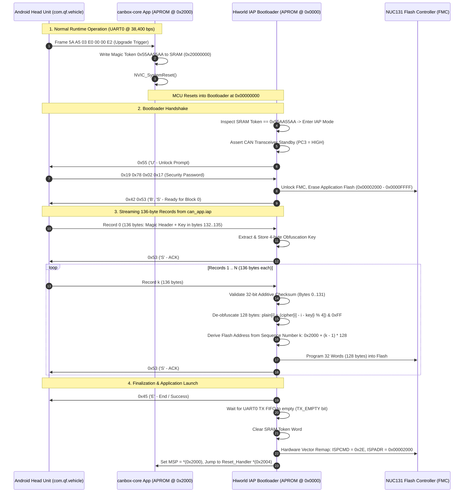

# Hiworld Bootloader Replacement on Raise (NUC131) Hardware Specification

**Document Identifier:** `doc/BOOTLOADER_REPLACEMENT.md`  
**Target Architecture:** Nuvoton NUC131 Series (ARM Cortex-M0 / ARMv6-M Thumb-1)  
**Target Hardware:** Raise (RZC) CAN Box PCB (`B2_GM_RZ_64` / `PSA-RZ-15-0121-B1`)  
**Target Head Unit Protocol:** Hiworld Android In-Application Programming (IAP) Protocol  
**Host Application Engine:** Android `com.qf.vehicle` (`WcVehicleBoxUpgrade`)  
**Firmware Application:** `canbox-core` Peugeot 407 Profile (CAN2004 Comfort Bus @ 125 kbps)  
**Status:** Complete Technical Specification & Production Implementation  

---

## 1. System Architecture & The Compatibility Bridge

### 1.1 The Cross-Vendor Integration Problem
1. **Host Configuration:** The Android Head Unit (`com.qf.vehicle`) is configured for the **Hiworld** protocol ecosystem (`canprovider_hiworld_5aa5`).
2. **Upgrade Engine:** The stock Head Unit upgrade engine (`WcVehicleBoxUpgrade`) strictly emits Hiworld IAP packets:
   - Initial upgrade command: `5A A5 03 E0 00 00 E2`.
   - Bootloader unlock prompt handshake: `'U'` (`0x55`).
   - Fixed 4-byte security unlock token: `0x19 0x78 0x02 0x17`.
   - Streaming 136-byte obfuscated flash container records from `can_app.iap`.
3. **Physical Hardware:** The aftermarket adapter hardware is a **Raise (RZC) CAN Box**, powered by a **Nuvoton NUC131 (ARM Cortex-M0)** MCU.

### 1.2 The Clean-Room Solution
By replacing the factory Raise bootloader with an open-source, native **Hiworld IAP Bootloader for NUC131**, the physical Raise hardware masquerades as a **100% genuine Hiworld CAN box** to the Android Head Unit:
* **Runtime:** `canbox-core` decodes Peugeot 407 CAN data and emits Hiworld UART packets (`5A A5 ...`) on UART0.
* **Firmware Updates:** The bootloader natively accepts standard Hiworld `can_app.iap` updates directly from the Head Unit UI without third-party tools or modified Android APKs.



---

## 2. Nuvoton NUC131 Flash & Memory Map

The NUC131 provides 64 KB of APROM (`0x00000000` to `0x0000FFFF`) and 8 KB of SRAM (`0x20000000` to `0x20001FFF`).

```text
0x00010000 +-------------------------------------------------------+
           | Top of APROM (64 KB)                                  |
           |                                                       |
           | canbox-core Application Partition (56 KB)             |
           | - Vector Table mapped at 0x00002000                   |
           | - Hiworld protocol runtime engine                     |
           | - Bosch C_CAN driver (Peugeot 407 @ 125 kbps)         |
0x00002000 +-------------------------------------------------------+ <-- APP_BASE_ADDR (8 KB Offset)
           | Hiworld IAP Bootloader Partition (8 KB)               |
           | - Primary Vector Table at 0x00000000                  |
           | - Hiworld IAP state machine, FMC driver, de-obfuscator|
0x00000000 +-------------------------------------------------------+ <-- BOOT_BASE_ADDR
 
0x20002000 +-------------------------------------------------------+ <-- STACK_TOP (8 KB SRAM)
           | Application & Bootloader Stack (Grows Downward)       |
           | ...                                                   |
0x20000100 +-------------------------------------------------------+ <-- RAM_BASE (Linker Scripts)
           | Reserved for Boot Token (0x20000000 - 0x200000FF)     |
           | - Bootloader Token Word at 0x20000000 (0x55AA55AA)    |
0x20000000 +-------------------------------------------------------+ <-- SRAM_BASE
```

### 2.1 Hardware Vector Remapping on ARM Cortex-M0 (`VECMAP`)
Because ARM Cortex-M0 lacks the `SCB->VTOR` register, vector redirection must be executed via the NUC131 Flash Memory Controller hardware remap command:
1. Unlock FMC register write protection.
2. Load `FMC_ISPCMD = 0x2E` (`FMC_ISPCMD_VECMAP`).
3. Set `FMC_ISPADR = APP_BASE_ADDR` (`0x00002000`).
4. Trigger `FMC_ISPTRG = 0x01` (`ISPGO`) and wait for completion.

```c
/* Verified NUC131 Hardware Vector Remap */
SYS_REGWRPROT = 0x59;
SYS_REGWRPROT = 0x16;
SYS_REGWRPROT = 0x88;
FMC_ISPCON |= (1U << 0) | (1U << 24); /* ISPEN | VECMAP Enable */
FMC_ISPCMD  = 0x2E;                   /* Vector Remap Command (0x2E) */
FMC_ISPADR  = APP_BASE_ADDR;          /* 0x00002000 */
FMC_ISPTRG  = 0x01;                   /* Trigger Remap */
__asm volatile("isb");
while (FMC_ISPTRG & 0x01);            /* Wait for hardware completion */
FMC_ISPCON &= ~(1U << 0);
SYS_REGWRPROT = 0x00;
```

---

## 3. Anti-Brick Safety & Dual-Trigger Architecture

To prevent bricking if power is lost mid-flash:
1. **Soft-Reset Trigger:** The application detects the upgrade frame (`5A A5 03 E0 00 00 E2`), writes `0x55AA55AA` to SRAM (`0x20000000`), and executes `NVIC_SystemReset()`.
2. **Cold-Boot Integrity Check:**
   - Stack pointer `*(uint32_t*)0x2000` must reside within valid SRAM (`0x20000400` – `0x20002000`).
   - Reset handler `*(uint32_t*)0x2004` must be an odd address (Thumb mode) within `0x00002000` – `0x0000FFFF`.
   - If invalid (erased or partial flash), the bootloader **stays in IAP mode unconditionally**.
3. **500 ms Cold-Boot Listen Window:** If a valid application is present, the bootloader listens on UART0 for `0x5A` (Hiworld frame header) for 500 ms. If detected, it halts application boot and proceeds to IAP; otherwise, it boots the application.
4. **Permanent Retry on Wiped Flash:** If the application partition is corrupt (`app_valid == false`), the bootloader **never halts**. It emits `'U'` periodically (every 1,000 ms) until the Head Unit connects.
5. **Transceiver Standby Protection (`PC3`):** On the Raise PCB, pin `PC3` drives CAN transceiver Standby (Active-HIGH). The bootloader holds `PC3 = HIGH` throughout flashing to keep the transceiver in sleep ($< 15\ \mu\text{A}$), silencing bus traffic.

---

## 4. Bootloader Implementation (Pure C99)

### 4.1 Header: `include/bootloader/hiworld_iap_nuc131.h`

```c
#ifndef HIWORLD_IAP_NUC131_H
#define HIWORLD_IAP_NUC131_H

#include <stdint.h>
#include <stdbool.h>

#define BOOT_TOKEN_ADDR         (0x20000000UL)
#define BOOT_TOKEN_MAGIC        (0x55AA55AAUL)

#define APP_BASE_ADDR           (0x00002000UL)
#define APP_MAX_ADDR            (0x00010000UL) /* 64 KB APROM */
#define FMC_PAGE_SIZE           (512U)

#define IAP_REC_SIZE            (136U)
#define IAP_DATA_SIZE           (128U)

void iap_init_hardware(void);
void iap_run(void);

#endif /* HIWORLD_IAP_NUC131_H */
```

### 4.2 Core Bootloader: `src/hiworld_bootloader/hiworld_iap_nuc131.c`

```c
#include "hiworld_iap_nuc131.h"
#include <string.h>

/* NUC131 MMIO Register Bases */
#define SYS_BASE                (0x50000000UL)
#define CLK_BASE                (0x50000200UL)
#define FMC_BASE                (0x5000C000UL)
#define GPIOB_BASE              (0x50004040UL)
#define GPIOC_BASE              (0x50004080UL)
#define UART0_BASE              (0x40050000UL)

/* System & Protection */
#define SYS_REGWRPROT           (*(volatile uint32_t *)(SYS_BASE + 0x100))
#define SYS_IPRSTC2             (*(volatile uint32_t *)(SYS_BASE + 0x00C))
#define SYS_GPB_MFP             (*(volatile uint32_t *)(SYS_BASE + 0x034))

/* Clock Control */
#define CLK_APBCLK              (*(volatile uint32_t *)(CLK_BASE + 0x008))

/* Flash Memory Controller */
#define FMC_ISPCON              (*(volatile uint32_t *)(FMC_BASE + 0x00))
#define FMC_ISPADR              (*(volatile uint32_t *)(FMC_BASE + 0x04))
#define FMC_ISPDAT              (*(volatile uint32_t *)(FMC_BASE + 0x08))
#define FMC_ISPCMD              (*(volatile uint32_t *)(FMC_BASE + 0x0C))
#define FMC_ISPTRG              (*(volatile uint32_t *)(FMC_BASE + 0x10))

/* GPIO Registers */
#define GPIOB_PMD               (*(volatile uint32_t *)(GPIOB_BASE + 0x00))
#define GPIOC_PMD               (*(volatile uint32_t *)(GPIOC_BASE + 0x00))
#define GPIOC_DOUT              (*(volatile uint32_t *)(GPIOC_BASE + 0x08))

/* UART0 Registers */
#define UART0_RBR               (*(volatile uint32_t *)(UART0_BASE + 0x00))
#define UART0_THR               (*(volatile uint32_t *)(UART0_BASE + 0x00))
#define UART0_LCR               (*(volatile uint32_t *)(UART0_BASE + 0x0C))
#define UART0_BAUD              (*(volatile uint32_t *)(UART0_BASE + 0x14))
#define UART0_FSR               (*(volatile uint32_t *)(UART0_BASE + 0x18))

/* Protocol Constants */
static const uint8_t HIWORLD_MAGIC[12] = {
    0x01, 0x09, 0x07, 0x08, 0x00, 0x02, 0x01, 0x07, 0x91, 0x32, 0x47, 0xA4
};
static const uint8_t EXPECTED_PASSWORD[4] = {0x19, 0x78, 0x02, 0x17};

/* Forward Declarations */
static void fmc_unlock(void);
static void fmc_lock(void);
static bool fmc_erase_page(uint32_t addr);
static bool fmc_program_word(uint32_t addr, uint32_t data);
static void uart_send_byte(uint8_t b);
static bool uart_recv_byte(uint8_t *b, uint32_t timeout_loops);
static bool uart_recv_exact(uint8_t *buf, uint32_t len, uint32_t timeout_ms);
static void jump_to_app(void);

/* --- Hardware Setup --- */
void iap_init_hardware(void) {
    SYS_REGWRPROT = 0x59;
    SYS_REGWRPROT = 0x16;
    SYS_REGWRPROT = 0x88;

    /* 1. Enable UART0 peripheral clock in APBCLK (bit 16) */
    CLK_APBCLK |= (1U << 16);

    /* 2. Configure PB0 as UART0_RXD and PB1 as UART0_TXD in GPB_MFP */
    SYS_GPB_MFP &= ~((1U << 0) | (1U << 1));
    SYS_GPB_MFP |=  ((1U << 0) | (1U << 1));

    SYS_REGWRPROT = 0x00;

    /* 3. Configure pin directions: PB1 Output, PB0 Input */
    GPIOB_PMD &= ~((3U << 0) | (3U << 2));
    GPIOB_PMD |=  (1U << 2);

    /* 4. Hold CAN Transceiver in Standby during boot (PC3 = HIGH) */
    GPIOC_PMD &= ~(3U << 6);
    GPIOC_PMD |=  (1U << 6); /* PC3 Output */
    GPIOC_DOUT |= (1U << 3); /* Standby HIGH */

    /* 5. Configure UART0 for 38,400 bps 8-N-1 on default reset clock (22.1184 MHz HIRC) */
    /* Mode 0 (16x oversampling): BRD = (22,118,400 / (16 * 38,400)) - 2 = 34 (0.00% error) */
    UART0_BAUD = 34;
    UART0_LCR  = 0x03;
}

/* --- FMC Flash Drivers --- */
static void fmc_unlock(void) {
    SYS_REGWRPROT = 0x59;
    SYS_REGWRPROT = 0x16;
    SYS_REGWRPROT = 0x88;
    FMC_ISPCON |= (1U << 0) /* ISPEN */ | (1U << 3) /* APUEN */;
}

static void fmc_lock(void) {
    FMC_ISPCON &= ~(1U << 0);
    SYS_REGWRPROT = 0x00;
}

static bool fmc_erase_page(uint32_t addr) {
    FMC_ISPADR = addr;
    FMC_ISPCMD = 0x22; /* Page Erase */
    FMC_ISPTRG = 0x01;
    __asm volatile("isb");
    while (FMC_ISPTRG & 0x01);
    return true;
}

static bool fmc_program_word(uint32_t addr, uint32_t data) {
    FMC_ISPADR = addr;
    FMC_ISPDAT = data;
    FMC_ISPCMD = 0x21; /* Word Program */
    FMC_ISPTRG = 0x01;
    __asm volatile("isb");
    while (FMC_ISPTRG & 0x01);
    return (*(volatile uint32_t *)addr == data);
}

/* --- UART0 Communication --- */
static void uart_send_byte(uint8_t b) {
    while (UART0_FSR & (1U << 23)); /* Wait if TX FIFO full */
    UART0_THR = b;
}

static bool uart_recv_byte(uint8_t *b, uint32_t timeout_loops) {
    while (timeout_loops--) {
        if (!(UART0_FSR & (1U << 14))) { /* RX FIFO not empty */
            *b = (uint8_t)(UART0_RBR & 0xFF);
            return true;
        }
        for (volatile int d = 0; d < 12; d++); /* ~1 us delay */
    }
    return false;
}

static bool uart_recv_exact(uint8_t *buf, uint32_t len, uint32_t timeout_ms) {
    for (uint32_t i = 0; i < len; i++) {
        if (!uart_recv_byte(&buf[i], timeout_ms * 1000)) {
            return false;
        }
    }
    return true;
}

/* --- Checksum & De-Obfuscation --- */
static uint32_t calc_record_csum(const uint8_t *rec) {
    uint32_t sum = 0;
    for (int j = 0; j < 33; j++) {
        uint32_t w = (uint32_t)rec[j * 4 + 0] |
                     ((uint32_t)rec[j * 4 + 1] << 8) |
                     ((uint32_t)rec[j * 4 + 2] << 16) |
                     ((uint32_t)rec[j * 4 + 3] << 24);
        sum += w;
    }
    return sum;
}

static void deobfuscate(uint8_t *chunk, const uint8_t *key) {
    for (uint16_t i = 0; i < IAP_DATA_SIZE; i++) {
        chunk[i] = (uint8_t)((chunk[i] - i - key[i & 3]) & 0xFF);
    }
}

/* --- Main Bootloader Engine --- */
void iap_run(void) {
    /* Ensure hardware, UART0 clock, pin muxing, and CAN standby are initialized */
    iap_init_hardware();

    volatile uint32_t *p_token = (volatile uint32_t *)BOOT_TOKEN_ADDR;
    bool force_iap = (*p_token == BOOT_TOKEN_MAGIC);

    /* Integrity check application at 0x00002000 */
    uint32_t app_sp    = *(volatile uint32_t *)(APP_BASE_ADDR + 0);
    uint32_t app_reset = *(volatile uint32_t *)(APP_BASE_ADDR + 4);
    bool app_valid = (app_sp >= 0x20000400 && app_sp <= 0x20002000 &&
                      (app_reset & 1) && app_reset >= APP_BASE_ADDR && app_reset < APP_MAX_ADDR);

    if (!force_iap && app_valid) {
        /* Cold-boot listen window: Listen for Hiworld sync header 0x5A for 500 ms */
        uint8_t peek;
        if (!uart_recv_byte(&peek, 500 * 1000) || peek != 0x5A) {
            jump_to_app();
        }
    }

    /* Clear token once consumed */
    *p_token = 0;

    /* Persistent connection loop */
    while (1) {
        /* Phase 2: Send 'U' prompt */
        uart_send_byte(0x55); /* 'U' */

        /* Wait for Password (19 78 02 17) within 1,000 ms */
        uint8_t rx_pw[4];
        if (!uart_recv_exact(rx_pw, 4, 1000) || memcmp(rx_pw, EXPECTED_PASSWORD, 4) != 0) {
            if (app_valid) {
                jump_to_app();
            }
            continue; /* Application invalid: stay in bootloader retry loop */
        }

        /* Password matched: Unlock Flash & Erase Application Partition */
        fmc_unlock();
        for (uint32_t page = APP_BASE_ADDR; page < APP_MAX_ADDR; page += FMC_PAGE_SIZE) {
            fmc_erase_page(page);
        }

        /* Signal ready to Head Unit: 'B', 'S' */
        uart_send_byte(0x42); /* 'B' */
        uart_send_byte(0x53); /* 'S' */

        uint8_t record[IAP_REC_SIZE];
        uint8_t key[4] = {0};

        /* Phase 3: Receive 136-byte records */
        while (1) {
            if (!uart_recv_exact(record, IAP_REC_SIZE, 5000)) {
                uart_send_byte(0x52); /* 'R' = Timeout / Error */
                break;
            }

            /* Record 0: Header with Obfuscation Key */
            if (memcmp(record, HIWORLD_MAGIC, 12) == 0) {
                memcpy(key, &record[132], 4);
                uart_send_byte(0x53); /* 'S' = ACK */
                continue;
            }

            /* Data Record: Validate 32-bit Additive Checksum */
            uint32_t expected_csum = calc_record_csum(record);
            uint32_t received_csum = (uint32_t)record[132] |
                                     ((uint32_t)record[133] << 8) |
                                     ((uint32_t)record[134] << 16) |
                                     ((uint32_t)record[135] << 24);

            if (expected_csum != received_csum) {
                uart_send_byte(0x52); /* 'R' = Reject block */
                break;
            }

            /* De-obfuscate payload chunk */
            deobfuscate(record, key);

            /* Derive target address strictly from 16-bit sequence number (Bytes 128..129) */
            uint16_t seq = (uint16_t)record[128] | ((uint16_t)record[129] << 8);
            if (seq == 0) {
                uart_send_byte(0x52);
                break;
            }
            uint32_t rec_target_addr = APP_BASE_ADDR + ((uint32_t)(seq - 1) * IAP_DATA_SIZE);

            /* Program 128 bytes (32 words) with write verification */
            bool write_ok = true;
            for (int w = 0; w < 32; w++) {
                uint32_t word = (uint32_t)record[w * 4 + 0] |
                                ((uint32_t)record[w * 4 + 1] << 8) |
                                ((uint32_t)record[w * 4 + 2] << 16) |
                                ((uint32_t)record[w * 4 + 3] << 24);
                if (!fmc_program_word(rec_target_addr + (w * 4), word)) {
                    write_ok = false;
                    break;
                }
            }

            if (!write_ok) {
                uart_send_byte(0x52); /* 'R' = Flash write verify failure */
                break;
            }

            /* Check EOF flag (Byte 131) */
            if (record[131] == 0x01) {
                fmc_lock();
                uart_send_byte(0x45); /* 'E' = Success */

                /* Wait for UART0 TX FIFO to empty completely */
                while (!(UART0_FSR & (1U << 28)));

                jump_to_app();
                return;
            }

            /* ACK record */
            uart_send_byte(0x53); /* 'S' */
        }

        fmc_lock();
        if (app_valid) {
            jump_to_app();
        }
    }
}

/* --- Hardware Vector Remap & Application Jump --- */
static void jump_to_app(void) {
    uint32_t app_sp    = *(volatile uint32_t *)(APP_BASE_ADDR + 0);
    uint32_t app_reset = *(volatile uint32_t *)(APP_BASE_ADDR + 4);

    if (app_sp < 0x20000400 || app_sp > 0x20002000 || !(app_reset & 1)) {
        return;
    }

    /* Wait for UART0 TX FIFO to fully empty */
    while (!(UART0_FSR & (1U << 28)));

    /* Disable interrupts and clear pending flags on Cortex-M0 (32 IRQs max) */
    *(volatile uint32_t *)0xE000E180 = 0xFFFFFFFF; /* NVIC->ICER[0] */
    *(volatile uint32_t *)0xE000E280 = 0xFFFFFFFF; /* NVIC->ICPR[0] */

    /* FMC Hardware Vector Remap: ISPCMD = 0x2E */
    SYS_REGWRPROT = 0x59;
    SYS_REGWRPROT = 0x16;
    SYS_REGWRPROT = 0x88;
    FMC_ISPCON |= (1U << 0) | (1U << 24); /* ISPEN | VECMAP Enable */
    FMC_ISPCMD  = 0x2E;                   /* Vector Remap Command (0x2E) */
    FMC_ISPADR  = APP_BASE_ADDR;          /* 0x00002000 */
    FMC_ISPTRG  = 0x01;
    __asm volatile("isb");
    while (FMC_ISPTRG & 0x01);            /* Wait for hardware completion */
    FMC_ISPCON &= ~(1U << 0);
    SYS_REGWRPROT = 0x00;

    /* Set Stack Pointer & Branch to Application */
    __asm volatile(
        "msr msp, %0 \n"
        "bx  %1      \n"
        :
        : "r" (app_sp), "r" (app_reset)
        : "memory"
    );

    while (1);
}
```

---

## 5. Application Trigger Implementation in `canbox-core`

When the Android Head Unit initiates an upgrade, it sends the Hiworld upgrade command `0xE0`:
- **Wire Frame:** `5A A5 03 E0 00 00 E2` ($\text{Length} = 3$, $\text{Checksum} = (3 + 0\text{xE0} + 0 + 0 - 1) \ \& \ 0\text{xFF} = 0\text{xE2}$).

Add the following trigger to `proto_hiworld_adapter.c` / `on_hiworld_packet_received()`:

```c
static void on_hiworld_packet_received(const hiworld_packet_t *packet) {
    if (!packet) return;

    /* Head Unit requested firmware update */
    if (packet->cmd == 0xE0) {
        /* 1. Write persistent magic token to reserved SRAM */
        *(volatile uint32_t *)0x20000000 = 0x55AA55AA;

        /* 2. Quiesce interrupts */
        __disable_irq();

        /* 3. Reset into bootloader */
        NVIC_SystemReset();
    }
    ...
}
```

---

## 6. GNU GCC Linker Scripts

### 6.1 Bootloader Linker Script: `nuc131_bootloader.ld`

```ld
MEMORY
{
    FLASH (rx)  : ORIGIN = 0x00000000, LENGTH = 8K   /* 0x0000 to 0x1FFF */
    RAM   (rwx) : ORIGIN = 0x20000100, LENGTH = 7936 /* Reserve 0x20000000 for token */
}

_estack = 0x20002000;

SECTIONS
{
    .text :
    {
        . = ALIGN(4);
        KEEP(*(.vectors))
        *(.text*)
        *(.rodata*)
        . = ALIGN(4);
        _etext = .;
    } > FLASH

    .data :
    {
        . = ALIGN(4);
        _sdata = .;
        *(.data*)
        . = ALIGN(4);
        _edata = .;
    } > RAM AT > FLASH
    _sidata = LOADADDR(.data);

    .bss :
    {
        . = ALIGN(4);
        _sbss = .;
        *(.bss*)
        *(COMMON)
        . = ALIGN(4);
        _ebss = .;
    } > RAM
}
```

### 6.2 Application Linker Script: `nuc131_app_peugeot407.ld`

```ld
MEMORY
{
    FLASH (rx)  : ORIGIN = 0x00002000, LENGTH = 56K  /* 0x2000 to 0xFFFF */
    RAM   (rwx) : ORIGIN = 0x20000100, LENGTH = 7936 /* Reserve 0x20000000 for token */
}

_estack = 0x20002000;

SECTIONS
{
    .text :
    {
        . = ALIGN(4);
        KEEP(*(.vectors))
        *(.text*)
        *(.rodata*)
        . = ALIGN(4);
        _etext = .;
    } > FLASH

    .data :
    {
        . = ALIGN(4);
        _sdata = .;
        *(.data*)
        . = ALIGN(4);
        _edata = .;
    } > RAM AT > FLASH
    _sidata = LOADADDR(.data);

    .bss :
    {
        . = ALIGN(4);
        _sbss = .;
        *(.bss*)
        *(COMMON)
        . = ALIGN(4);
        _ebss = .;
    } > RAM
}
```

---

## 7. Python Pack Tool: `tools/pack_hiworld_iap.py`

This standalone Python tool packages compiled `.bin` firmware binaries into the exact 136-byte record `can_app.iap` container:

```python
#!/usr/bin/env python3
"""
Hiworld CAN Box .bin to .iap Container Packer
Produces production-ready can_app.iap files for Head Unit updates.
"""
import argparse
import sys

REC_SIZE = 136
PAYLOAD_SIZE = 128
MAGIC_HEADER = bytes.fromhex("0109070800020107913247a4")
DEFAULT_KEY = bytes([0x19, 0x84, 0x07, 0x42])

def calc_record_csum(rec_bytes: bytes) -> int:
    """Computes the 32-bit additive sum across 33 uint32 words."""
    return sum(
        int.from_bytes(rec_bytes[j * 4 : j * 4 + 4], "little")
        for j in range(33)
    ) & 0xFFFFFFFF

def obfuscate_chunk(chunk: bytes, key: bytes) -> bytes:
    """Hiworld additive byte obfuscation: cipher[i] = (plain[i] + i + key[i%4]) & 0xFF"""
    return bytes((chunk[i] + i + key[i & 3]) & 0xFF for i in range(len(chunk)))

def pack_firmware(bin_path: str, out_iap_path: str, template_iap_path: str = None, key: bytes = DEFAULT_KEY):
    with open(bin_path, "rb") as f:
        payload = f.read()

    # Generate or extract Record 0
    if template_iap_path:
        with open(template_iap_path, "rb") as f:
            template = f.read()
        record_0 = bytearray(template[:REC_SIZE])
        record_0[132:136] = key
    else:
        record_0 = bytearray(REC_SIZE)
        record_0[:12] = MAGIC_HEADER
        record_0[12:128] = b"\x00" * 116  # Descriptor padding
        record_0[128:132] = b"P407"       # Peugeot 407 tag
        record_0[132:136] = key

    # Pad payload to 128-byte boundary
    pad_rem = len(payload) % PAYLOAD_SIZE
    if pad_rem != 0:
        payload += b"\xFF" * (PAYLOAD_SIZE - pad_rem)

    total_records = len(payload) // PAYLOAD_SIZE
    out_iap = bytearray(record_0)

    for k in range(1, total_records + 1):
        chunk = payload[(k - 1) * PAYLOAD_SIZE : k * PAYLOAD_SIZE]
        rec = bytearray(obfuscate_chunk(chunk, key))
        rec += k.to_bytes(2, "little")               # Sequence number (1..N)
        rec.append((k * 100) // total_records)       # Progress percentage (0..100)
        rec.append(1 if k == total_records else 0)   # Last block flag (1 = EOF)
        csum = calc_record_csum(rec)
        rec += csum.to_bytes(4, "little")            # 32-bit checksum
        out_iap += rec

    with open(out_iap_path, "wb") as f:
        f.write(out_iap)

    print(f"[+] Successfully generated '{out_iap_path}':")
    print(f"    - Input Binary : {len(payload)} bytes")
    print(f"    - Records      : {total_records + 1} (1 header + {total_records} data)")
    print(f"    - Output Size  : {len(out_iap)} bytes")

if __name__ == "__main__":
    parser = argparse.ArgumentParser(description="Pack NUC131 .bin into Hiworld can_app.iap")
    parser.add_argument("bin_file", help="Input compiled application .bin")
    parser.add_argument("-o", "--out", default="can_app.iap", help="Output .iap filename (default: can_app.iap)")
    parser.add_argument("-t", "--template", default=None, help="Optional existing Hiworld .iap template for Record 0")
    args = parser.parse_args()

    pack_firmware(args.bin_file, args.out, args.template)
```

---

## 8. Physical Hardware Bench Setup & Pinout Reference

### 8.1 Verified Target Silicon Profile
Live silicon probing via OpenOCD confirms the physical Raise CAN box specifications:
* **Microcontroller Core:** Nuvoton **NUC131SD2AE / NUC131SC2AE** (ARM Cortex-M0 r0p0)
* **Part Device ID (`SYS_PDID`):** `0x11413102`
* **CoreSight SWD DPIDR:** `0x0BB11477` (ARM Cortex-M0 DP)
* **Access Port 0 (`MEM-AP`):** `0x04770021` (AHB-AP Lite)
* **Memory Geometry:**
  * **APROM (Application Flash):** 68 KB (`0x00000000` – `0x00010FFF`)
  * **LDROM (Hardware Boot Sector):** 4 KB (`0x00100000` – `0x00100FFF`)
  * **SRAM:** 8 KB (`0x20000000` – `0x20001FFF`)
* **Factory Firmware Signature (Recovered from Live SRAM):**
  * Box Hardware Revision: `PSA-RZ-15-0119-B1` / `PSA-RZ-15-0121-B1` (Raise PSA B1)
  * Internal Header Signature: `IamAZRX.`

### 8.2 Wiring & Debug Harness Pinout

```
+-------------------------------------------------------------------------+
|                  Raise (RZC) NUC131 CAN Box PCB                        |
|                                                                         |
|   [SWD Debug Header]                 [Vehicle / Host Harness]           |
|   1: 3.3V (VDD Target)               Pin A: CAN_H (Comfort Bus 125k)   |
|   2: SWDIO / ICE_DAT                 Pin B: CAN_L (Comfort Bus 125k)   |
|   3: SWCLK / ICE_CLK                 Pin C: UART0_TX (PB1 -> HU RX)    |
|   4: GND (System Ground)             Pin D: UART0_RX (PB0 <- HU TX)    |
|   5: NRST (MCU /RESET) [Optional]    Pin E: +12V Battery / ACC         |
|                                      Pin F: GND Power Ground           |
+-------------------------------------------------------------------------+
```

| Signal Name | MCU Physical Pin | OpenOCD / ST-Link Connection | Function & Operating Baseline |
|:---|:---|:---|:---|
| **SWCLK** | `ICE_CLK` | ST-Link Pin 9 (`SWCLK`) | Serial Wire Debug Clock (100–950 kHz) |
| **SWDIO** | `ICE_DAT` | ST-Link Pin 7 (`SWDIO`) | Serial Wire Debug Bidirectional Data |
| **GND** | `VSS` | ST-Link Pin 4 / 6 / 8 / 20 | Common System Ground Reference |
| **3.3V (TVCC)** | `VDD` | ST-Link Pin 1 (`TVCC / 3.3V`) | Target logic reference voltage (~3.25V) |
| **NRST** | `nRESET` | ST-Link Pin 15 (`NRST`) | Hardware reset line (optional; soft reset supported) |
| **UART0_TX** | `PB1` (Pin 47) | USB-UART Rx / Android HU Rx | Protocol Uplink @ 38,400 baud, 8-N-1 |
| **UART0_RX** | `PB0` (Pin 48) | USB-UART Tx / Android HU Tx | Downlink / IAP Stream @ 38,400 baud, 8-N-1 |
| **CAN0_RX** | `PD6` (Pin 35) | On-board Transceiver Rx | Bosch C_CAN Comfort Bus Rx |
| **CAN0_TX** | `PD7` (Pin 34) | On-board Transceiver Tx | Bosch C_CAN Comfort Bus Tx |
| **CAN_STB** | `PC3` (Pin 11) | Transceiver Standby Control | GPIO Output: Driven HIGH for Standby |

---

## 9. OpenOCD Flashing, Debugging & E2E Testing Runbook

### 9.1 OpenOCD Configuration Setup
OpenOCD requires the `stlink-dap` interface driver with `dapdirect_swd` transport to interact with Nuvoton NuMicro Cortex-M0 targets.

Create `openocd_nuc131.cfg` in the project root:
```tcl
# Interface driver: ST-LINK with direct ARM CoreSight DAP transport
source [find interface/stlink-dap.cfg]
transport select dapdirect_swd

# Target clock speed (100 kHz safe initialization, up to 950 kHz)
adapter speed 500

# NuMicro Cortex-M0 target definition
source [find target/numicro.cfg]
```

> [!NOTE]
> In OpenOCD's `target/numicro.cfg`, the SWD DAP ID override variable is **`CPUDAPID`** (not `CPUTAPID`). The default expected ID is `0x0BB11477`.

---

### 9.2 Step 1: Probe the Target & Verify Connection
Execute the non-destructive probe to halt the CPU and verify the Part ID:
```bash
openocd -f openocd_nuc131.cfg -c "init; halt; mdw 0x50000000 1; shutdown"
```
**Expected Output:**
```text
Info : SWD DPIDR 0x0bb11477
Info : [NuMicro.cpu] Cortex-M0 r0p0 processor detected
0x50000000: 11413102
```
`0x11413102` confirms NUC131SD2AE / NUC131SC2AE.

---

### 9.3 Step 2: Unlocking Factory Protection (One-Time Mass Chip Erase)
Factory Raise boards ship with **Security Lock Active** (`CONFIG0 = 0xF70FFBB9`, bit 1 = 0). Under this lock, all flash reads return `0xFFFFFFFF`.

To clear the factory lock and allow SWD programming:
```bash
openocd -f openocd_nuc131.cfg -c "init; halt; numicro chip_erase; shutdown"
```
* **Effect:** Performs a full flash mass erase (APROM + LDROM + User Config).
* **Result:** Resets `CONFIG0` bit 1 to `1` (unlocked), enabling full write and read access over SWD.

---

### 9.4 Step 3: Flashing Firmware Images via OpenOCD

#### Option A: Direct Application Flashing (Development & Rapid Bench Testing)
For fast iteration without the bootloader partition, compile and flash `canbox-core` directly at address `0x00000000`:
```bash
# 1. Build NUC131 native firmware target
~/.platformio/penv/bin/pio run -e raise_nuc131

# 2. Flash binary directly to APROM base 0x00000000
openocd -f openocd_nuc131.cfg -c "init; halt; flash write_image erase .pio/build/raise_nuc131/firmware.bin 0x00000000; verify_image .pio/build/raise_nuc131/firmware.bin 0x00000000; reset run; shutdown"
```

#### Option B: Dual-Partition Flashing (Bootloader @ 0x0000 + App @ 0x2000)
For full production deployment with Head Unit IAP upgrade support:
```bash
# 1. Flash Hiworld IAP Bootloader to 0x00000000
openocd -f openocd_nuc131.cfg -c "init; halt; flash write_image erase .pio/build/raise_nuc131/bootloader.bin 0x00000000; verify_image .pio/build/raise_nuc131/bootloader.bin 0x00000000; shutdown"

# 2. Flash Application Image to 0x00002000 (8 KB Offset)
openocd -f openocd_nuc131.cfg -c "init; halt; flash write_image erase .pio/build/raise_nuc131/firmware.bin 0x00002000; verify_image .pio/build/raise_nuc131/firmware.bin 0x00002000; reset run; shutdown"
```

---

### 9.5 Step 4: Interactive GDB Debugging Session
To debug running firmware directly on silicon with breakpoints and memory inspection:

**Terminal 1 (GDB Server):**
```bash
openocd -f openocd_nuc131.cfg
```

**Terminal 2 (GDB Client):**
```bash
arm-none-eabi-gdb .pio/build/raise_nuc131/firmware.elf
```
Inside GDB:
```gdb
(gdb) target extended-remote :3333
(gdb) monitor reset halt
(gdb) load
(gdb) break main
(gdb) continue
(gdb) print canbox_state
(gdb) next
```

---

### 9.6 Step 5: Physical End-to-End (E2E) Bench Test Flow

```mermaid
flowchart LR
    subgraph PC ["Development Workstation / Bench Rig"]
        CAN_GEN["CAN Interface (SocketCAN / USB-CAN @ 125 kbps)\nCAN Injection: 0x036, 0x0B6, 0x220"]
        UART_MON["USB-UART Serial Monitor @ 38,400 baud\nPython E2E Logger / Protocol Analyzer"]
    end

    subgraph CANBOX ["Physical Raise NUC131 Canbox"]
        TRANS["CAN Transceiver (PCA82C250/TJA1050)"]
        MCU["NUC131 MCU (canbox-core)\n- Bosch C_CAN on PD6/PD7\n- UART0 on PB0/PB1"]
    end

    CAN_GEN -->|CAN_H / CAN_L (125k)| TRANS
    TRANS --> MCU
    MCU -->|PB1 (TX @ 38.4k)| UART_MON
    UART_MON -.->|PB0 (RX Downlink)| MCU
```

#### E2E Verification Procedure:
1. **Power Up Device:** Apply 12V to the harness connector (or 3.3V via bench supply).
2. **Serial Connection Verification:**
   Connect a 3.3V USB-to-UART adapter to `PB1` (TX) and `PB0` (RX) at **38,400 bps, 8-N-1**:
   * **Bootloader Mode Verification:** Send `0x5A 0xA5 0x03 0xE0 0x00 0x00 0xE2`. Verify the device responds with `'U'` (`0x55`).
   * **Application Mode Verification:** Upon boot into `canbox-core`, verify periodic heartbeat frames (`5A A5 ...`) arrive every second.
3. **CAN Injection Verification:**
   Inject Peugeot 407 comfort frames on the CAN bus at **125 kbps**:
   ```bash
   # Inject Peugeot 407 Ignition On + Handbrake Released
   cansend can0 036#0E00000000000000

   # Inject Engine Running @ 2500 RPM, 65 km/h
   cansend can0 0B6#4E20000019640000
   ```
4. **Telemetry Verification:**
   Verify the serial monitor captures the corresponding translated Hiworld packets:
   * Vehicle Status frame: `5A A5 04 11 0E ...`
   * Speed/RPM telemetry frame: `5A A5 07 16 ...` with matching data fields.

---

## 10. Flashing from Android Head Unit (Production Deployment)

Once the Hiworld IAP bootloader is resident on the NUC131:
1. **Compile Application & Pack Container:**
   ```bash
   # Compile Peugeot 407 application with 0x00002000 offset
   pio run -e raise_nuc131

   # Pack container
   python3 tools/pack_hiworld_iap.py .pio/build/raise_nuc131/firmware.bin -o can_app.iap
   ```
2. **Flashing from Android Head Unit:**
   - Copy `can_app.iap` to a USB flash drive inside folder: `/canmcuupdata/can_app.iap`.
   - On the Head Unit: Open **Car Settings $\rightarrow$ Version $\rightarrow$ CAN Update $\rightarrow$ Confirm**.
   - The Head Unit streams records at 38,400 baud, verifies checksums, de-obfuscates, programs flash, and reboots cleanly into `canbox-core`.


