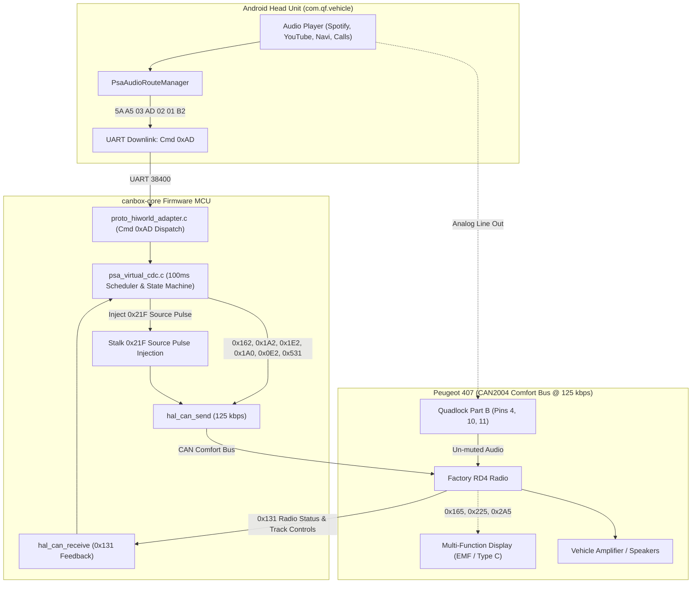

# Peugeot RD4 Virtual CD Changer (CDC) Emulation Engine Specification

## Document Target: CAN Box Firmware Developer & Firmware AI Agents
**Applicable Vehicle Platforms:** PSA Peugeot 407, 307, 207, 308, 607, 807, Citroën C4, C5 (RD4 Audio Architecture)  
**Target Head Unit Application:** `com.qf.vehicle` (`PsaAudioRouteManager`, `PeugeotDataParser`, `OriginalMediaPlayer`)  
**Target Hardware Protocol:** Hiworld PSA CAN Box UART Protocol (38,400 baud, 8N1)  
**Vehicle Network:** PSA CAN2004 / AEE2004 Comfort Bus @ 125 kbps  
**Reference Implementations:** `CDCEmu` (Blaupunkt PSA CDC emulator firmware), OEM Peugeot RD4 vehicle dumps  

---

## 1. Architectural Overview & Problem Statement

In Peugeot 407 vehicles equipped with the factory **Blaupunkt / Continental RD4 radio**, integrating aftermarket Android Head Units without losing OEM vehicle telemetry or steering column stalk controls presents an audio routing challenge:

1. **AUX Input Limitations:** Factory RD4 AUX 1 / AUX 2 inputs often require Diagbox/Lexia activation, suffer from low pre-amp gain or high-impedance hum, and require manually pressing the `SOURCE` button every trip.
2. **Factory CD Changer Port:** The RD4 features an external CD Changer (CDC) differential audio input on **Quadlock Connector Part B** (Pins 4, 10, 11). However, the RD4 mutes this input and excludes the CDC source from its source rotation unless an authentic CD Changer is present and actively heartbeating on the CAN Comfort bus (125 kbps).
3. **Display Clashing Pitfall (0x165 / 0x1A5 / 0x1E5 Collision):** Some legacy or unverified implementations attempted to transmit `0x165`, `0x1A5`, and `0x1E5`. Real vehicle testing (`dump_2026-10-12_23-13-48.log`) proved that these IDs are actually broadcast *by the RD4 radio itself* to the Multi-Function Display (MFD). Transmitting on them clobbers the RD4 display frames, causing the center screen to flicker erratically between volume level and source name.
4. **Authentic Blaupunkt Architecture:** As proven by real vehicle captures and the verified `CDCEmu` project, the authentic PSA CD Changer communicates using its own dedicated CAN ID set (`0x162`, `0x1A2`, `0x1E2`, `0x1A0`, `0x0E2`, `0x531`) and listens to commands from the radio on `0x131`.

`canbox-core` implements an autonomous **Virtual CD Changer (CDC) Emulation Engine** that solves this completely:
- Emulates the authentic Blaupunkt 5/6-disc CDC on the CAN Comfort bus.
- Continuously advertises CDC availability (enabled by default, optionally toggleable).
- Intercepts downlink control commands (`Cmd 0xAD`) from the Android Head Unit.
- Automatically handles source switching via virtual COM2000 stalk pulse injection (`0x21F`).
- Un-mutes the RD4 Quadlock Part B pre-amp, providing clean, high-fidelity audio from Android to the car speakers.



---

## 2. Factory Hardware Wiring: RD4 Quadlock Connector

The audio signal from the Android Head Unit (RCA / Line Out L, R, GND) connects directly to the 12-pin **Part B** sub-connector of the factory RD4 Quadlock:

```
                      RD4 Quadlock Rear Connector
    ┌─────────────────────────────────────────────────────────┐
    │  [Part A: Power, CAN, Speakers]                         │
    │  Pin 9: CAN High (Comfort Bus @ 125k)                   │
    │  Pin 10: CAN Low  (Comfort Bus @ 125k)                  │
    │  Pin 12: Ground                                         │
    │  Pin 15: +12V Battery Constant                          │
    ├────────────────────────────┬────────────────────────────┤
    │  [Part B: CD Changer Port] │  [Part C: AUX 1 / AUX 2]   │
    │  Pin 4:  Audio Right (+)   │  Pin 4:  AUX 1 Audio Right │
    │  Pin 10: Audio Left (+)    │  Pin 10: AUX 1 Audio Left  │
    │  Pin 11: Audio Ground/Shield│ Pin 11: AUX 1 Ground      │
    │  Pin 2:  CDC Data (Unused) │                            │
    └────────────────────────────┴────────────────────────────┘
```

| Quadlock Part B Pin | Function | Connection to Android Head Unit |
|:---:|:---|:---|
| **Pin 4** | CD Changer Audio Right (+) | Android Head Unit Audio Line Out Right (RCA Red center) |
| **Pin 10** | CD Changer Audio Left (+) | Android Head Unit Audio Line Out Left (RCA White center) |
| **Pin 11** | CD Changer Audio Common Ground / Shield | Android Head Unit Audio Ground (RCA Outer shields) |
| *Pin 2* | CDC Data Out (OEM K-line) | Not Connected (handled entirely via CAN bus) |

---

## 3. Ground-Truth CAN Protocol Specification (125 kbps)

All frames are standard 11-bit CAN IDs broadcast at **125 kbps** on the PSA Comfort network.

### 3.1 Transmitted CDC Frames (`canbox-core` $\to$ Vehicle Bus)

#### 1. `CAN 0x162` — CDC Status & Presence Heartbeat
- **Repetition Rate:** **100 ms periodic** (Every single 100 ms scheduler tick)
- **DLC:** 7
- **Payload Structure:**
  ```text
  Byte 0: [0xA0] Radio & System Enabled bitmask (0xA0 if radio on, 0x20 if standby)
  Byte 1: [Flags & Status Icon]
          Bits 2..0: Status Icon (3 = Play, 2 = Pause, 1 = Stop, 6 = None)
          Bit 1 (0x02): Active Playback Flag
  Byte 2: [0x06] Magic constant
  Byte 3: [Disc Number] (1..6, default 1)
  Byte 4: [0x00] Reserved
  Byte 5: [0x06] CRITICAL SOURCE REGISTRATION MAGIC BYTE
  Byte 6: [0x00] Reserved
  ```
  > [!IMPORTANT]
  > **Byte 5 Magic Byte (`0x06`):** The RD4 firmware will **NOT** register the CDC in its available audio source list if Byte 5 is zero. It must be set to `0x06` matching the authentic Blaupunkt firmware.

#### 2. `CAN 0x1A2` — Disc Total Tracks
- **Repetition Rate:** **500 ms periodic** (Every 5 ticks of 100 ms)
- **DLC:** 5
- **Payload:** `[ total_tracks, 0x58, 0x00, 0x00, 0x00 ]`
  - `Byte 0 = 99` (`0x63` / `TRACK_MAX`): Reports 99 tracks available on the virtual disc.
  - `Byte 1 = 0x58`: Blaupunkt protocol status flag.

#### 3. `CAN 0x1E2` — Current Track & Elapsed Time
- **Repetition Rate:** **500 ms periodic** (Every 5 ticks of 100 ms)
- **DLC:** 7
- **Payload:** `[ track_num, 0x05, 0x00, elapsed_min, elapsed_sec, 0x00, 0x00 ]`
  - `Byte 0`: Active track number ($1 \dots 99$).
  - `Byte 1`: Status subcode (`0x05`).
  - `Byte 3`: Elapsed playback minutes ($0 \dots 59$).
  - `Byte 4`: Elapsed playback seconds ($0 \dots 59$).

#### 4. `CAN 0x1A0` — Play Modes (Intro / Random / Repeat)
- **Repetition Rate:** **500 ms periodic** (Every 5 ticks of 100 ms)
- **DLC:** 2
- **Payload:**
  - `Byte 0`: `0x92 | (intro ? 0x20 : 0x00) | (random ? 0x04 : 0x00)`
  - `Byte 1`: `(repeat ? 0x80 : 0x00)`

#### 5. `CAN 0x531` — CDC Device Alive Heartbeat
- **Repetition Rate:** **1000 ms periodic** (Every 10 ticks of 100 ms)
- **DLC:** 8
- **Payload:** `[ 0x09, 0x00, 0x00, 0x00, 0x00, 0x00, 0x00, 0x00 ]`
  - Signals to the BSI and Audio Gateway that the CDC physical ECU is alive.

#### 6. `CAN 0x0E2` — Magazine Disc Map
- **Repetition Rate:** **1000 ms periodic** (Every 10 ticks of 100 ms)
- **DLC:** 8
- **Payload:** `[ 0x00, 0x00, 0x00, (active_disc << 4), 0x00, 0x03, 0x33, 0x33 ]`
  - Maps loaded disc slots in the virtual 6-disc magazine.

---

### 3.2 Inbound Control Frame (`CAN 0x131` from RD4 Radio $\to$ `canbox-core`)

The OEM RD4 head unit transmits `0x131` (DLC 5) every 100 ms to supervise the CD Changer:
- **Identifier:** `0x131`
- **DLC:** 5
- **Payload Structure:**
  - `Byte 0`:
    - Bit 7 (`0x80`): Radio powered on (`radio_enabled`).
    - Bit 6 (`0x40`): Previous Track request from steering stalk.
    - Bit 5 (`0x20`): Next Track request from steering stalk.
    - Bit 1 (`0x02`): Radio actively selected CDC as the current source (`radio_playing_cdc`).
  - `Byte 1`:
    - Bit 7 (`0x80`): Repeat Mode toggle.
    - Bit 0 (`0x01`): Random / Shuffle toggle.
  - `Byte 2`: Target Disc Slot number ($1 \dots 6$, or 0 if unchanged).
  - `Byte 4`: Target Track number ($1 \dots 99$, or 0 if unchanged).

`canbox-core` parses `0x131` in `psa_virtual_cdc_process_can_0x131()`:
- Automatically tracks when the user switches to CDC via the car's physical radio controls.
- Increments or decrements `track_num` when the user uses the COM2000 steering wheel stalk scroll / track buttons.

---

## 4. Head Unit Downlink UART Protocol (`Cmd 0xAD`)

The Android Head Unit communicates with `canbox-core` via standard Hiworld UART framing:
```
[ 0x5A, 0xA5, <LEN>, 0xAD, <SubCmd>, <Param>, <Checksum> ]
```
Where Checksum is:
$$\text{Checksum} = \left( \left( \text{LEN} + \text{CMD} + \sum \text{Payload} \right) - 1 \right) \ \& \ \mathtt{0xFF}$$

### 4.1 Supported Sub-Commands

| SubCmd | Parameter Range | Description | Wire Frame Example | `canbox-core` Action |
|:---:|:---:|:---|:---|:---|
| **`0x01`** | `0x00` / `0x01` | **Enable / Disable CDC Emulation** | `5A A5 03 AD 01 01 B1` (Enable)<br>`5A A5 03 AD 01 00 B0` (Disable) | Sets `enabled` flag. When disabled, all CAN periodic transmissions cease immediately. Enabled by default. |
| **`0x02`** | `0x00` / `0x01` | **Audio Play / Standby** | `5A A5 02 AD 02 01 B1` (Play)<br>`5A A5 02 AD 02 00 B0` (Standby) | `0x01`: Sets playback active, pulses stalk `0x21F` (SRC) to switch RD4 source.<br>`0x00`: Standby mode (`status_icon = 2`), keeps presence heartbeat alive. |
| **`0x03`** | `0x01` / `0x02` | **Switch RD4 Source** | `5A A5 02 AD 03 01 B3` (Tuner)<br>`5A A5 02 AD 03 02 B4` (CD) | `0x01`: Switches RD4 to FM/AM Tuner via `0x21F` stalk pulses.<br>`0x02`: Switches RD4 to Internal CD via `0x21F` stalk pulses. |
| **`0x0E`** | `0x01 .. 0x06` | **Select Disc Slot** | `5A A5 03 AD 0E 01 BE` (Disc 1) | Updates `active_disc` reported in `0x162` and `0x0E2`. |
| **`0x0F`** | `0x00 .. 0x3B` | **Set Elapsed Seconds** | `5A A5 03 AD 0F 14 D2` (20 sec) | Updates `elapsed_sec` reported in `0x1E2`. |
| **`0x10`** | `0x01 .. 0x63` | **Set Track Number** | `5A A5 03 AD 10 05 C4` (Track 5) | Updates `track_num` reported in `0x1E2`. |

---

## 5. Automatic Source Switching & Virtual COM2000 Stalk Injection

When Android starts playback (YouTube, Spotify, incoming Bluetooth call) or switches audio sources, the Head Unit issues `Cmd 0xAD`:
- `Cmd 0xAD SubCmd 0x02 Param 0x01`: Switch to CDC.
- `Cmd 0xAD SubCmd 0x02 Param 0x00`: CDC Standby.
- `Cmd 0xAD SubCmd 0x03 Param 0x01`: Switch to Tuner.
- `Cmd 0xAD SubCmd 0x03 Param 0x02`: Switch to Internal CD.
- `Cmd 0x0F`: Tuner query + station list trigger (Scroll UP / DOWN pulse on `0x21F`).

### 5.1 Virtual Stalk Injection Primitive (`CAN 0x21F`)
To switch the RD4 source without requiring driver dashboard interaction:
1. `canbox-core` checks `state->media.radio.source_mode` and `power_status`.
2. If the current source is not the target source:
   - Injects momentary `SOURCE` key pulses on virtual COM2000 stalk:
     - **Press Frame:** `CAN 0x21F` (DLC 3: `[ 0x02, <cnt>, 0x00 ]`).
     - **Hold Duration:** 60 ms.
     - **Release Frame:** `CAN 0x21F` (DLC 3: `[ 0x00, <cnt>, 0x00 ]`).
     - **Debounce Interval:** 120 ms between pulses.
   - Repeats until `CAN 0x165` confirms target source reached (up to 5 retries).
3. When CDC is active, `canbox-core` emits Hiworld `Cmd 0x84` (`0x31` = CDC) to notify the Head Unit.

---

## 6. Optional Configuration & C API Reference

The Virtual CDC Emulation Engine is designed to be **optional but enabled by default**. It is fully decoupled from hardware and allocates zero heap memory (`sizeof(psa_virtual_cdc_t)` is 16 bytes statically allocated).

### 6.1 Public Header (`include/profiles/psa_virtual_cdc.h`)

```c
/* Initializes state machine (enabled = true, active_disc = 1, total_tracks = 99) */
void psa_virtual_cdc_init(void);

/* Runtime toggle: enables or disables the emulation engine */
void psa_virtual_cdc_set_enabled(bool enabled);

/* Sets playback active (triggers stalk 0x21F pulse if needed) or standby */
void psa_virtual_cdc_set_state(bool active);

/* Processes downlink command from Head Unit (Cmd 0xAD) */
void psa_virtual_cdc_handle_hu_cmd(uint8_t subcmd, uint8_t param);

/* Switches RD4 source to target (1: Tuner, 2: Internal CD, 3: Virtual CDC) */
void psa_virtual_cdc_switch_source(uint8_t target_source);

/* Emits Scroll UP + DOWN pulse on 0x21F to trigger RD4 station list */
void psa_virtual_cdc_trigger_station_list(void);

/* Updates / gets rolling COM2000 stalk thumbwheel counter */
void psa_virtual_cdc_update_stalk_rotary(uint8_t rotary_cnt);
uint8_t psa_virtual_cdc_get_stalk_rotary(void);

/* Ingests OEM CAN feedback */
void psa_virtual_cdc_process_can_0x131(const uint8_t *data, uint8_t dlc);
void psa_virtual_cdc_process_can_0x165(uint8_t source_mode, uint8_t power_status);

/* 100ms periodic scheduler: broadcasts 0x162, 0x1A2, 0x1E2, 0x1A0, 0x531, 0x0E2 */
void psa_virtual_cdc_tick_100ms(void);

/* Status accessors */
bool psa_virtual_cdc_is_active(void);
bool psa_virtual_cdc_is_presence_enabled(void);
const psa_virtual_cdc_t *psa_virtual_cdc_get_context(void);
```

---

## 7. Verification & Automated Test Vectors

### 7.1 Unit Tests (`test/test_protocol_parser/test_peugeot_407.c`)
- `test_peugeot_407_virtual_cdc_initial_state`: Verifies default initialization (`enabled = true`, standby, default disc 1, track 1, 99 total tracks, transmission of `0x162` with magic byte `0x06`).
- `test_peugeot_407_virtual_cdc_downlink_controls`: Verifies `SubCmd 0x0E` (disc), `0x0F` (sec), `0x10` (track), `0x02` (play/pause), and `0x01` (enable/disable optional toggle).
- `test_peugeot_407_virtual_cdc_periodic_transmission`: Verifies 500 ms group (`0x1A0`, `0x1A2`, `0x1E2`), 1000 ms group (`0x531`, `0x0E2`), and `0x131` track skip decoding.

### 7.2 Integration Tests (`test/test_integration/test_integration_hiworld.c`)
- `test_integration_hiworld_virtual_cdc_pipeline`: End-to-end integration test through the CAN router and UART parser:
  - Ingestion of downlink `5A A5 03 AD 02 01 B2`.
  - Generation of universal ACK `5A A5 01 FF AD AC`.
  - Emission of `Cmd 0x84` (`0x31` CDC active).
  - Transmission of CAN `0x162` with magic byte `0x06`.
  - Disabling via `5A A5 03 AD 01 00 B0` (verifies zero CAN frames transmitted).
  - Re-enabling via `5A A5 03 AD 01 01 B1` (verifies resumption of CAN transmissions).

