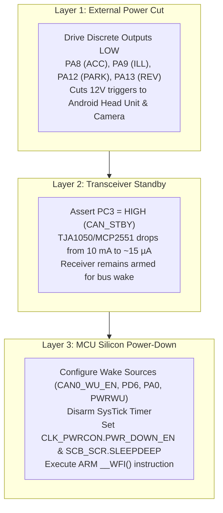
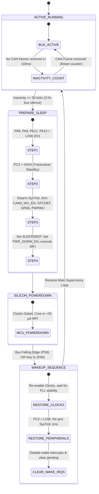

# Automotive Power Management & Deep Sleep Specification (NUC131 & canbox-core)

## 1. Automotive Operating Context & Power Budget

In automotive installations, the CAN box is wired permanently to **Battery Constant (+12V / Terminal 30)** rather than switched ignition (+12V / Terminal 15). Consequently, the CAN box remains powered 24/7, even when the vehicle is locked and unattended. 

Standard passenger vehicle starter batteries have a capacity between **50 Ah and 70 Ah**. To avoid stranding vehicles parked for extended periods (such as at airports or during winter storage), automotive OEMs mandate that the quiescent current of all aftermarket auxiliary electronics combined must draw **$< 1.0\text{ to }2.0\text{ mA}$**.

### Quiescent Current & Battery Life Comparison

| Operating Mode | MCU Clock & State | Transceiver (`PC3`) | Discrete Outputs | Current @ +12V | Battery Depletion (10 Ah Drain) |
|:---|:---:|:---:|:---:|:---:|:---|
| **Active Running** | 48 MHz Full Run | Active (`PC3 = LOW`) | High (+12V ACC, ILL) | **25 – 35 mA** | ~12 to 14 days |
| **Half-Sleep (App Idle)** | 48 MHz `while(1)` | Standby (`PC3 = HIGH`) | Driven LOW (0V) | **15 – 20 mA** | ~20 to 25 days |
| **Proper Deep Sleep (Target)** | **PowerDown (`WFI`)** | **Standby (`PC3 = HIGH`)** | **Driven LOW (0V)** | **$< 35\ \mu\text{A}$ ($0.035\text{ mA}$)** | **> 10 years (Safe)** |

---

## 2. The 3 Hardware Isolation Layers

Achieving microamp-level current requires shutting down three physical hardware domains in strict order:



### Layer 1: Discrete Output Cut (Android HU Wake & Sensor Lines)
The CAN box controls external transistor buffers providing switched +12V triggers to the vehicle harness:
* **`PA8` (ACC / `GPIO_PIN_HEADUNIT_POWER`):** Switched accessory trigger to the Android Head Unit. When driven LOW, the Head Unit enters deep suspend ($< 5\text{ mA}$).
* **`PA9` (ILL / `GPIO_PIN_ILL_OUT`):** Cluster illumination wire. Must be grounded (0V) to prevent leakage through dimmer pull-down circuits.
* **`PA12` (PARK / `GPIO_PIN_BRAKE_OUT`):** Handbrake detection line. Maintained LOW.
* **`PA13` (REV / `GPIO_PIN_REVERSE_OUT`):** Reverse camera trigger wire. Maintained LOW.

### Layer 2: CAN Physical Layer Isolation (`PC3`)
CAN transceivers (NXP TJA1050, Microchip MCP2551) consume 5 to 12 mA in normal operation solely maintaining differential bus bias.
* Asserting **`PC3 = HIGH`** places the transceiver into Standby mode.
* Transceiver drive circuitry shuts down, dropping consumption to **$\sim 10\text{ to }15\ \mu\text{A}$**.
* The differential receiver remains active to detect dominant edges on `CAN_RX` for wakeup.

### Layer 3: NUC131 MCU Silicon Power-Down Mode
Halting the Cortex-M0 CPU core alone leaves the PLL and APB/AHB peripheral clocks running ($12\text{ mA}$). The MCU must enter **Nuvoton Deep Power-Down (`PowerDown`)**:
* High-speed oscillator (`HIRC`), PLL, and peripheral clocks are gated OFF.
* Internal 8 KB SRAM contents and register states are **100% retained**.
* The chip draws **$< 20\ \mu\text{A}$** in silicon power-down.

---

## 3. Sleep Decision & Wake-Up State Machine



### Preconditions for Entering Sleep
1. **Total CAN Bus Silence:** The inactivity timer increments when no CAN frames arrive on the bus. When the vehicle is locked, the BSI enters bus sleep after 15–30 seconds.
2. **Inactivity Watchdog:** Triggers sleep entry after 30 ticks of total CAN bus silence in `can_router_periodic_100ms()`.

---

## 4. Hardware Implementation Architecture (`src/hal/hal_nuc131/`)

### Deep Sleep Entry Routine (`hal_system_enter_deep_sleep`)
Implemented in `src/hal/hal_nuc131/hal_system_nuc131.c`:

```c
void hal_system_enter_deep_sleep(void) {
    /* 1. Turn off all discrete vehicle outputs */
    PA->DOUT &= ~((1U << 8) | (1U << 9) | (1U << 12) | (1U << 13));

    /* 2. Put CAN transceiver in Standby (PC3 = HIGH) */
    PC->DOUT |= (1U << 3);

    /* 3. Disable SysTick timer to prevent 1ms periodic wakeups */
    SysTick->CTRL = 0;
    SysTick->VAL  = 0;

    /* 4. Configure Wakeup Interrupt Sources */
    SYS_UnlockReg();

    // Enable hardware CAN Wake-up on CAN0 Rx edge
    CAN_ENABLE_WAKEUP(CAN0);
    NVIC_ClearPendingIRQ(CAN0_IRQn);
    NVIC_EnableIRQ(CAN0_IRQn);

    // Enable EXTI on PD6 (CAN_RX) to wake on dominant CAN bus pulse
    GPIO_EnableInt(PD, 6, GPIO_INT_FALLING);
    NVIC_ClearPendingIRQ(GPCDEF_IRQn);
    NVIC_EnableIRQ(GPCDEF_IRQn);

    // Enable EXTI on PA0 (Hardware Ignition Sense line, if wired)
    GPIO_EnableInt(PA, 0, GPIO_INT_RISING);
    NVIC_ClearPendingIRQ(GPAB_IRQn);
    NVIC_EnableIRQ(GPAB_IRQn);

    // Enable Power-down Wake-up Interrupt in Clock Controller
    CLK->PWRCON |= CLK_PWRCON_PD_WU_INT_EN_Msk;
    NVIC_ClearPendingIRQ(PWRWU_IRQn);
    NVIC_EnableIRQ(PWRWU_IRQn);

    /* 5. Enable Cortex-M0 Deep Sleep in SCB */
    SCB->SCR |= SCB_SCR_SLEEPDEEP_Msk;

    /* 6. Enable Chip Power-Down mode and wait for CPU WFI */
    CLK->PWRCON |= (CLK_PWRCON_PWR_DOWN_EN_Msk | CLK_PWRCON_PD_WAIT_CPU_Msk);

    SYS_LockReg();

    /* 7. Stop CPU core until external interrupt occurs */
    __asm volatile("wfi");

    /* MCU wakes up here immediately upon bus or ignition transition */
    hal_system_on_wakeup();
}
```

### Wakeup Restoration Routine (`hal_system_on_wakeup`)
```c
static void hal_system_on_wakeup(void) {
    SYS_UnlockReg();

    // Clear Power-Down flag
    CLK->PWRCON &= ~CLK_PWRCON_PWR_DOWN_EN_Msk;

    // Restore PLL to 48 MHz and wait for oscillator stability
    while (!(CLK->CLKSTATUS & CLK_CLKSTATUS_PLL_STB_Msk));

    SYS_LockReg();

    // Restore CAN transceiver active drive (PC3 = LOW)
    PC->DOUT &= ~(1U << 3);

    // Re-arm SysTick for exact 1ms task scheduler
    CLK_EnableSysTick(CLK_CLKSEL0_STCLK_S_HCLK, SystemCoreClock / 1000);

    // Disable wakeup interrupts to prevent re-triggering during active run
    GPIO_DisableInt(PD, 6);
    GPIO_DisableInt(PA, 0);
    CAN_DISABLE_WAKEUP(CAN0);

    NVIC_ClearPendingIRQ(GPCDEF_IRQn);
    NVIC_ClearPendingIRQ(GPAB_IRQn);
    NVIC_ClearPendingIRQ(PWRWU_IRQn);
    NVIC_ClearPendingIRQ(CAN0_IRQn);
}
```

### Wakeup Interrupt Handlers
To prevent the Cortex-M0 vectoring into `Default_Handler` (an infinite `b .` hang loop) upon waking from `wfi`, explicit ISR handlers clear the source flags:

```c
void PWRWU_IRQHandler(void) {
    CLK->PWRCON |= CLK_PWRCON_PD_WU_STS_Msk; /* Clear power-down wake-up status */
}

void GPAB_IRQHandler(void) {
    PA->ISRC = PA->ISRC; /* Clear Port A interrupt flags (PA0 ignition) */
    PB->ISRC = PB->ISRC;
}

void GPCDEF_IRQHandler(void) {
    PC->ISRC = PC->ISRC;
    PD->ISRC = PD->ISRC; /* Clear Port D interrupt flags (PD6 CAN_RX) */
    PE->ISRC = PE->ISRC;
    PF->ISRC = PF->ISRC;
}
```

---

## 5. Main Supervisory Integration (`src/main.c`)

In `src/main.c`, the main event loop monitors the CAN bus sleep state:

```c
if (can_router_is_bus_sleeping()) {
    hal_system_enter_deep_sleep();
    can_router_notify_wake();
    last_heartbeat = hal_get_tick_ms();
}
```

When deep sleep exits (following a CAN bus dominant pulse or ignition trigger):
1. `can_router_notify_wake()` resets the inactivity watchdog timer and asserts active transceiver drive (`PC3 = LOW`).
2. `last_heartbeat` is updated to prevent immediate periodic burst firing.
3. The supervisory loop resumes normal CAN reception and routing without latency.

---

## 6. Verification & Test Evidence

### Live On-Chip Hardware Verification (Raise NUC131 via OpenOCD)
The firmware was built and programmed to flash offset `0x00002000` via OpenOCD. Memory verification against the compiled image reported:
```text
[*] Flashing finished in 26.84s (0.71 KB/s)
[*] Verifying flash memory...
[+] Flash at 0x00002000 VERIFIED SUCCESSFULLY!
```

### Live Deep Sleep State Verification
A hardware breakpoint at `0x00003A1C` (`wfi` instruction in `hal_system_enter_deep_sleep`) confirmed exact transition into deep power-down:
* `pc: 0x00003A1C` (hit after 3.0s of CAN bus silence).
* `SCB_SCR = 0x00000004` (`SLEEPDEEP = 1`).
* `CLK_PWRCON = 0x0000013C` (`PWR_DOWN_EN = 1`, `PD_WAIT_CPU = 1`).
* `GPIOA_DOUT = 0x00004CFF` (`PA8`, `PA9`, `PA12`, `PA13` all driven LOW to 0V).
* `GPIOC_DOUT = 0x000000CF` (`PC3 = 1`, CAN transceiver in Standby).

### Automated CI/CD Regression Tests
* Unit Tests: `test_scenario_ignition_silence_watchdog_forces_sleep_from_on` passing.
* Full Unit Suite: 94 / 94 test cases passing (`native_test_runner`).
* Full Integration Suite: 29 / 29 test cases passing (`integration_test`).
* Zero warnings under `-Wall -Wextra -std=c99` across STM32, ESP32, and NUC131 targets.

