# OpenCanbox Core: Hiworld PSA Peugeot 407 Implementation Progress & Specification Tracker

**Target Vehicle Platform:** Peugeot 407 (PSA CAN2004 / AEE2004 Comfort Bus @ 125 kbps)  
**Target Head Unit Protocol:** Hiworld PSA (`0x5A 0xA5` Framing, Additive Checksum, UART 38,400 baud, 8N1)  
**Target Head Unit Application:** `com.qf.vehicle` (Peugeot Hiworld `wc` Driver / QF Canbus System)  
**Reference Protocol Specifications:** `commands_and_payload_structure.md`, `doc/CANBOX_SPEC_HIWORLD_407_*.md`, `doc/FIRMWARE_BUILD_AND_FLASH_GUIDE.md`  
**Firmware Core Project:** `canbox-core` (Pure C99 Embedded Automotive Firmware, Zero Heap)  
**Last Updated:** October 2026  

---

## 1. Executive Summary & Architecture Pipeline

This document tracks the complete development, verification status, and actionable roadmap of **OpenCanbox Core** (`canbox-core`) tailored **strictly and exclusively to the Hiworld PSA protocol on the Peugeot 407 platform**.

All decoders strictly operate on **verified PSA CAN2004 Comfort Bus frames (@ 125 kbps)**. Speculative CAN2010 definitions (e.g. radar on `0x260`/`0x270` or unconfirmed steering angle frames) and non-Hiworld protocol details (Raise, Bagoo, VAG) are strictly excluded from this tracker.

### End-to-End Pipeline Mapping

```mermaid
flowchart LR
    subgraph Car["Peugeot 407 CAN2004 Comfort Bus (125 kbps)"]
        BSI_POW["0x036 (Ignition, Lighting, Handbrake)"]
        BSI_FAST["0x0B6 (Engine RPM, Speed)"]
        RADAR["0x0E1 (AAS Parking Radar Proximity)"]
        STALK["0x0F6 / 0x128 (Stalk Keys & Reverse Bit)"]
        ALERTS["0x1A1 (Real-Time Popups) / 0x120 (Journal)"]
        CLIM["0x1D0 / 0x1E3 (Dual HVAC Status)"]
        DOORS["0x220 (Doors, Boot, Bonnet Status)"]
        TRIP["0x221 / 0x2A1 / 0x261 (Trip Computer P0/P1/P2)"]
        TPMS["0x3A1 / 0x361 / 0x1E1 (Tire Pressures & Alarms)"]
        RADIO["0x225 / 0x2A5 / 0x3A6 (RD4 Tuner, RDS & CDC)"]
    end

    subgraph Core["canbox-core (Pure C99 Engine)"]
        L1["L1: CAN Rx (hal_can)"]
        L2["L2: Profile Decoder (peugeot_407.c)"]
        L3["L3: Router & State Cache (can_router.c)"]
        L4["L4: Protocol Driver Interface (hu_protocol_driver.h)"]
        L5["L5: Hiworld Protocol Adapter (proto_hiworld_adapter.c & hiworld_connection.c)"]
        GPIO["Physical Hardware Synthesis (ACC / ILL / REVERSE)"]
    end

    subgraph HU["Android Head Unit (com.qf.vehicle) / Host"]
        UART["UART Receiver"]
        CTRL["PeugeotDataController (wc)"]
        PARSER["PeugeotDataParser"]
        UI["UI Panels, Overlays & Floating Toasts"]
    end

    Car -->|"CAN Frames @ 125k"| L1
    L1 --> L2 --> L3 --> L4 --> L5
    L3 -.->|"Pin Triggers"| GPIO
    L5 -->|"UART (38400 baud, 5A A5 framing)"| UART
    UART --> CTRL --> PARSER --> UI
    UI -.->|"Downlink Commands (0x1B, 0x2F, 0x3B, 0xCB)"| UART
    UART -.->|"UART Downlink"| L5
    L5 -.->|"Downlink CAN Tx (0x221, 0x39B, 0x228)"| L1
    L1 -.->|"CAN Frames"| Car
```

---

## 2. High-Level Hiworld PSA Progress Overview

| Functional Subsystem | Total Features | Completed `[x]` | In Progress `[-]` | Planned `[ ]` | N/A | Completion % |
| :--- | :---: | :---: | :---: | :---: | :---: | :---: |
| **1. Protocol Connection & Handshake** | 6 | 6 | 0 | 0 | 0 | **100%** |
| **2. Steering Wheel Controls & Keys** | 3 | 3 | 0 | 0 | 0 | **100%** |
| **3. Dual-Zone Climate Control (HVAC)** | 3 | 2 | 1 | 0 | 0 | **67%** |
| **4. Doors, Body & Apertures** | 2 | 2 | 0 | 0 | 0 | **100%** |
| **5. Trip Computer & Telemetry** | 5 | 5 | 0 | 0 | 0 | **100%** |
| **6. Parking Radar (OPS / AAS)** | 2 | 2 | 0 | 0 | 0 | **100%** |
| **7. Tire Pressure Monitoring (TPMS)** | 3 | 2 | 0 | 1 | 0 | **67%** |
| **8. BSI Vehicle Alerts & Diagnostics** | 5 | 5 | 0 | 0 | 0 | **100%** |
| **9. Central Personalization & Settings** | 4 | 2 | 2 | 0 | 0 | **50%** |
| **10. Date & Time Synchronization** | 2 | 1 | 1 | 0 | 0 | **50%** |
| **11. RD4 Audio & Multimedia Passthrough (inc. Virtual CDC & DSP)**| 6 | 6 | 0 | 0 | 0 | **100%** |
| **12. Dynamic Guidelines & Steering SAS**| 1 | 1 | 0 | 0 | 0 | **100%** |
| **13. Powertrain & Hardware GPIO Synthesis**| 5 | 5 | 0 | 0 | 0 | **100%** |
| **14. Dynamic CAN ID Pre-filtering & Router**| 1 | 1 | 0 | 0 | 0 | **100%** |
| **15. Commercial Hardware & IAP Bootloader** | 2 | 2 | 0 | 0 | 0 | **100%** |
| **Overall** | **50** | **45** | **3** | **2** | **0** | **90%** |

---

## 3. Hiworld Master Command Implementation Matrix

Cross-referenced directly against `commands_and_payload_structure.md` and Android `com.qf.vehicle` / `wc` driver:

### 3.1 Inbound Telemetry Commands (CAN Box $\to$ Host / Android HU)

| Status | CMD | Name / Category | Wire LEN | Vehicle CAN ID | Core Files / Drivers | Test Verification & Notes |
| :---: | :---: | :--- | :---: | :---: | :--- | :--- |
| `[x]` | `0xF0` | **Version String Report** | Variable | N/A (Firmware) | `src/core/canbox_version.c` `src/protocols/hiworld_connection.c` `src/protocols/proto_hiworld_adapter.c` | `test_hiworld_verification_vector_2_version_report` `test_canbox_embedded_firmware_version` Dynamically embedded `CANBOX-CORE-V<YYYYMMDD.hhmmss>` generated at build time via `tools/generate_version.py` (buffer expanded to 64 bytes) |
| `[x]` | `0x11` | **Steering Wheel Keys (SWC)** | `0x0A` (10) | `0x21F` `0x221` `0x0F6` | `src/profiles/peugeot_407.c` `src/protocols/proto_hiworld_adapter.c` | `test_peugeot_407_stalk_0x21f_buttons_and_rotary` `test_peugeot_407_stalk_tip_0x221_trip_button` `test_integration_hiworld_native_stalk_0x21f_pipeline` `test_integration_hiworld_stalk_tip_0x221_trip_pipeline` `test_peugeot_407_stalk_buttons_press_and_release` `test_peugeot_407_stalk_rotary_encoder` `test_integration_hiworld_steering_wheel_volume_up_pipeline` Spec: `doc/CANBOX_SPEC_HIWORLD_407_01_STEERING_STALK_KEYS.md` |
| `[x]` | `0x12` | **Doors & Apertures Status** | `0x0B` (11) | `0x220` `0x036` | `src/profiles/peugeot_407.c` `src/protocols/proto_hiworld_adapter.c` | `test_peugeot_407_doors_hiworld_vector_1_driver_front` `test_integration_hiworld_door_status_pipeline` 10 payload bytes: FL, FR, RL, RR, trunk, bonnet, handbrake |
| `[x]` | `0x13` | **Instantaneous Trip Telemetry** | `0x0B` (11) | `0x221` | `src/profiles/peugeot_407.c` `src/protocols/proto_hiworld_adapter.c` | `test_peugeot_407_trip_hiworld_vector_1_instant_fuel` `test_integration_hiworld_trip_pipeline` Instant fuel ($0.1\text{ L/100km}$), DTE range, target distance |
| `[x]` | `0x14` | **Trip 1 Computer Telemetry** | `0x07` (7) | `0x2A1` | `src/profiles/peugeot_407.c` `src/protocols/proto_hiworld_adapter.c` | `test_peugeot_407_trip_hiworld_vector_2_trip1_historical` Trip 1 avg fuel, avg speed, trip distance |
| `[x]` | `0x15` | **Trip 2 Computer Telemetry** | `0x07` (7) | `0x261` | `src/profiles/peugeot_407.c` `src/protocols/proto_hiworld_adapter.c` | `test_peugeot_407_trip_hiworld_vector_3_trip2_historical` Trip 2 avg fuel, avg speed, trip distance |
| `[x]` | `0x21` | **Console Panel Button Telemetry**| `0x02` (2) | `0x3E5` only | `src/profiles/peugeot_407.c` (`psa_decode_console_0x3e5_ex`) `src/protocols/proto_hiworld_adapter.c` | `test_peugeot_407_console_0x3e5_buttons` `test_peugeot_407_console_0x3e5_edge_cases` `test_integration_hiworld_console_0x3e5_full_pipeline` `test_integration_hiworld_console_0x3e5_ok_pipeline` Spec: `doc/CANBOX_SPEC_HIWORLD_407_01_STEERING_STALK_KEYS.md` section 3.3 Verified KeyIDs (OEM Canbox): AUDIO `0x31`, TRIP `0x40`, CLIM `0x28`, DARK `0x07`, OK `0x24`, ESC `0x25`, MENU `0x2E`, UP `0x17`, DOWN `0x18`, LEFT `0x19`, RIGHT `0x1A`. `0x3E5` 2-bit fields: B0 MENU[7:6] CLIM[1:0]; B1 TRIP[7:6] AUDIO[1:0]; B2 OK[7:6] ESC[5:4] DARK[3:2]; B5 UP[7:6] DOWN[5:4] RIGHT[3:2] LEFT[1:0]. Captured in `can_log_buttons*.log`: AUDIO, TRIP, CLIM, DARK, MENU, OK, ESC, UP; DOWN/LEFT/RIGHT bits from simulator docs (not yet captured). TEL decoded (B0[5:4] -> Hiworld `0x05` PHONE, unverified on vehicle, not yet captured); MODE pending (no KeyID). `0x167`/`0x0DF` decoders removed. CMD `0x22` and OEM idle `0x11` frame pending. |
| `[x]` | `0x11` | **Dynamic Trajectory Steering Angle (SAS)** | `0x0A` (10) | `0x10B` (BSI-routed from CAN IS `0x305`), `0x0F6` (reverse gate) | `src/profiles/profile_psa.c` (`psa_decode_steering_angle_0x10b_profile`) `src/core/can_router.c` `src/protocols/proto_hiworld_adapter.c` (`hiworld_send_steering_angle`) | `test_integration_hiworld_steering_angle_trajectory_pipeline` Spec: `doc/CANBOX_SPEC_HIWORLD_407_05_STEERING_ANGLE_SAS.md`. Angle = `-(raw/10)` whole degrees, sent only in reverse gear on change; Byte 3 != 0 or `0x7FFF` discarded. Cmd `0x1A` mirror pending (layout not documented). |
| `[x]` | `0x84` | **RD4 Radio / Audio Source State** | `0x0E` (14) | `0x165` `0x225` `0x2A5` `0x265` | `src/profiles/peugeot_407.c` (`psa_rd4_decode_frame`, `psa_rd4_process_can_0x165`, `psa_rd4_process_can_0x225`, `psa_rd4_process_can_0x2a5`, `build_hiworld_radio_state`) `src/profiles/profile_psa.c` `src/protocols/proto_hiworld_adapter.c` `src/core/can_router.c` | `test_peugeot_407_rd4_vector_1_fm_tuner` `test_peugeot_407_rd4_source_and_wavebands` `test_peugeot_407_rd4_frequency_and_ta_stability` `test_peugeot_407_aux_mode_suppression` `test_integration_hiworld_rd4_radio_tuner_pipeline` `test_integration_hiworld_rd4_downlink_resume_queries` `test_integration_hiworld_rd4_aux_mode_pipeline` `test_integration_hiworld_rd4_radio_off_suppresses_cd_tuner_frames` Spec: `doc/CANBOX_SPEC_HIWORLD_407_09_RD4_MFD_MEDIA_TEXT.md` Unified RD4 state machine: `0x165` is sole authority over `present`, `sleep`, `power_status`, and `source_mode`; sub-frames (`0x225`, `0x2A5`, `0x265`) cache tuner state without overriding `OFF` (`0xFF`) or external sources (`>= 0x20`). Emits one-shot `0x84 0xFF` when RD4 is OFF and suppresses background tuner/CD frames while OFF (no flip-flopping). |
| `[x]` | `0x86` | **RDS Dynamic RadioText Marquee** | $1\dots 64$ | `0x0A4` | `src/profiles/peugeot_407.c` (`psa_rd4_decode_frame`, `psa_rd4_process_can_0x0a4`, `build_hiworld_radio_text`) `src/protocols/proto_hiworld_adapter.c` `src/core/can_router.c` | `test_peugeot_407_rd4_vector_2_isotp_radiotext` `test_integration_hiworld_rd4_radiotext_pipeline` `test_integration_hiworld_rd4_radio_off_suppresses_cd_tuner_frames` Spec: `doc/CANBOX_SPEC_HIWORLD_407_09_RD4_MFD_MEDIA_TEXT.md` ISO-TP reassembly strips prefix `10 00 00 00`; routes to `tv_radio_text`; strictly suppressed in AUX / external source modes and when RD4 radio is off (`source_mode >= 0x20`) |
| `[x]` | `0x85` | **RD4 Station Preset Memory List** | `0x0D` (18) / `0x31` (54) | `0x225` `0x125` | `src/profiles/peugeot_407.c` (`psa_rd4_decode_frame`, `psa_rd4_process_can_0x125`, `build_hiworld_radio_preset_freqs`, `build_hiworld_radio_preset_names`) `src/protocols/proto_hiworld_adapter.c` (`hiworld_send_radio_presets`) `src/core/can_router.c` | `test_peugeot_407_rd4_preset_memory_list` `test_integration_hiworld_rd4_preset_list_pipeline` `test_integration_hiworld_rd4_aux_mode_pipeline` `test_integration_hiworld_rd4_radio_off_suppresses_cd_tuner_frames` Spec: `doc/CANBOX_SPEC_HIWORLD_407_09_RD4_MFD_MEDIA_TEXT.md` section 3.4 & 3.6 Supports Standard Frequency Mode (13 payload / 18 wire bytes, 6x `uint16_be`) and Extended Station Names Mode (49 payload / 54 wire bytes, 6x 8-ASCII station names decoded from native CAN `0x125` ISO-TP station list streams) mapped to `mPrefebArray` in `PeugeotDataParser.smali::parseCarRadioPreFrequency`; dual-purpose backwards-compatible with 508 Sport/Eco Mode (`parseCentralState`) when payload $\le 6$; strictly suppressed in AUX / external source modes and when RD4 radio is off (`source_mode >= 0x20`) |
| `[x]` | `0x97` | **CD & CD Changer (CDC) Playback State** | `0x0B` (11) | `0x325` `0x365` `0x3A5` `0x3A6` | `src/profiles/peugeot_407.c` (`psa_rd4_decode_frame`, `psa_rd4_process_can_0x325`, `psa_rd4_process_can_0x365`, `psa_rd4_process_can_0x3a5`, `psa_rd4_process_can_0x3a6`, `build_hiworld_media_state`) `src/protocols/proto_hiworld_adapter.c` `src/core/can_router.c` | `test_peugeot_407_cd_changer_and_rds` `test_peugeot_407_rd4_vector_3_cd_changer` `test_peugeot_407_rd4_cd_in_dash_playback` `test_peugeot_407_rd4_cd_tray_mechanism` `test_peugeot_407_rd4_cd_ground_truth_dump` `test_integration_hiworld_rd4_cd_changer_pipeline` `test_integration_hiworld_rd4_cd_in_dash_pipeline` `test_integration_hiworld_rd4_downlink_resume_queries` `test_integration_hiworld_rd4_radio_off_suppresses_cd_tuner_frames` Spec: `doc/CANBOX_SPEC_HIWORLD_407_09_RD4_CD.md` Full in-dash single CD drive (`0x325` tray presence, `0x365` total tracks & MP3 flag, `0x3A5` track/elapsed/status/repeat/random) and 6-disc CDC (`0x3A6`) supported; Little-Endian `uint16_le` track & total tracks wire format; Play status code `0x02` aligned with `OriginalMediaPlayer`; Hiworld `0x97` adapter active; strictly dispatched only in CD/CDC mode (`0x30`/`0x31`) |
| `[x]` | `0x31` | **Dual-Zone Climate Status** | `0x0D` (13) | `0x1D0` `0x1E3` | `src/profiles/peugeot_407.c` `src/protocols/proto_hiworld_adapter.c` | `test_peugeot_407_hvac_hiworld` `test_peugeot_407_rear_defrost_detection` `test_integration_hiworld_outside_temp_pipeline` Power, AC, auto, dual, defrost, fan (0..8), temps, AQS, airflow; outside temp from `0x0F6` byte 5 (raw*0.5-40 C, `0xFF` invalid) via `psa_decode_bsi_slow_0x0f6` in `src/profiles/profile_psa.c` -> payload[11] |
| `[x]` | `0x41` | **Parking Radar Distance (OPS)** | `0x0D` (13) | `0x0E1` | `src/profiles/peugeot_407.c` `src/protocols/proto_hiworld_adapter.c` | `test_peugeot_407_radar_hiworld_vector_1_obstacle_rear_center` `test_integration_hiworld_radar_pipeline` 8 sensor bars (0..4 distance level); strictly CAN2004 `0x0E1` |
| `[x]` | `0x42` | **PSA BSI Vehicle Alert DTCs** | `0x03` / `0x19` | `0x1A1` `0x120` | `src/profiles/peugeot_407.c` `src/protocols/proto_hiworld_adapter.c` | `test_peugeot_407_alert_single_abs` `test_peugeot_407_alert_journal_multi` Matches Section 5 DTC table; controlled via compile flag |
| `[x]` | `0x56` | **RD4 Volume & Audio Settings (DSP)** | `0x0D` (13) | `0x1A5` `0x1E5` | `src/profiles/peugeot_407.c` `src/protocols/proto_hiworld_adapter.c` `src/core/can_router.c` | `test_peugeot_407_rd4_volume` `test_peugeot_407_rd4_audio_settings` `test_peugeot_407_rd4_hiworld_frame_build` `test_integration_hiworld_rd4_volume_and_audio_pipeline` Spec: `doc/PEUGEOT_RD4_VOLUME_AND_DSP_SPEC.md`. Bias-63 level conversion (-9..0..+9 -> 0..9..18), EQ presets (0..5), loudness (0x10), speed-dependent volume boolean (0x01), master volume (0..30), activity flag decoding on `0x1A5` bits [7:5] (`0x00` active, `0xE0` idle unmuted, `0x80` mute), anti-flicker delta dispatch, and gated 1000ms passive sync |
| `[x]` | `0x66` | **TPMS Direct Numeric Pressures** | `0x07` (7) | `0x3A1` `0x361` | `src/profiles/peugeot_407.c` `src/protocols/proto_hiworld_adapter.c` | `test_peugeot_407_tpms_hiworld_vector_1_nominal` `test_integration_hiworld_tpms_pipeline` 4-wheel tire pressures in bar / deci-bar |
| `[x]` | `0x71` | **Feature Enable Availability 1** | `0x03` (3) | Fixed / Config | `src/protocols/hiworld_connection.c` | `test_hiworld_verification_vector_3_feature_enables` Reports supported vehicle feature bitmask (`0x60`, `0x12`) |
| `[x]` | `0x72` | **Feature Enable Availability 2** | `0x09` (9) | Fixed / Config | `src/protocols/hiworld_connection.c` | `test_hiworld_verification_vector_3_feature_enables` Reports supported feature bitmask (`0x00, 0x01, 0x80...`) |
| `[x]` | `0x76` | **Central Convenience State 1** | `0x03` (3) | Fixed / BSI | `src/protocols/hiworld_connection.c` | `test_hiworld_verification_vector_3_feature_enables` |
| `[x]` | `0x79` | **Central Convenience State 2** | `0x09` (9) | Fixed / BSI | `src/protocols/hiworld_connection.c` | `test_hiworld_verification_vector_3_feature_enables` Reports dual-zone configuration & vehicle settings |
| `[-]` | `0x7B` | **Convenience & Exterior Settings**| `0x03` (3) | `0x39B` `0x2A8` | `doc/CANBOX_SPEC_HIWORLD_407_11_CAR_CONFIGURATION_OPTIONS.md` | Uplink state decoded; Downlink command mapping pending |
| `[ ]` | `0x7D` | **TPMS Calibration State** | `0x03` (3) | `0x1E1` | `src/protocols/proto_hiworld_adapter.c` | Documented in `commands_and_payload_structure.md` |
| `[-]` | `0x8A` | **Speed Limiter Presets Feedback** | `0x0B` (11) | `0x1A8` | `src/profiles/peugeot_407.c` | `test_psa_extended_decode_cruise_0x1a8` CAN decoder verified; serializer to Hiworld pending |
| `[-]` | `0x8B` | **Cruise Control Presets Feedback**| `0x0B` (11) | `0x1A8` | `src/profiles/peugeot_407.c` | `test_psa_extended_decode_cruise_0x1a8` CAN decoder verified; serializer to Hiworld pending |
| `[-]` | `0x8C` | **Vehicle Clock Sync Feedback** | `0x08` (8) | `0x228` | `src/protocols/hiworld_connection.c` | `test_hiworld_verification_vector_4_gps_time_sync` |
| `[x]` | `0xC1` | **System Units Broadcast** | `0x04` (4) | Fixed / Config | `src/protocols/hiworld_connection.c` | `test_hiworld_verification_vector_3_feature_enables` Units: L/100km, km/h, Celsius (`0x28, 0x20, 0x00`) |
| `[ ]` | `0xC2` | **Date & Time Broadcast** | `0x08` (8) | `0x228` | `src/protocols/hiworld_connection.c` | Uplink vehicle clock broadcast |
| `[-]` | `0xCB` | **Extended Powertrain Telemetry** | `0x0B` (11) | `0x0B6` `0x165` | `src/profiles/peugeot_407.c` | Engine RPM & Speed decoded in `peugeot_407.c`; packaging to `0xCB` planned |
| `[x]` | `0xEA` | **Custom Extended CAN Alerts** | `0x06` / Variable | `0x1A1` `0x120` | `src/profiles/peugeot_407.c` `src/protocols/proto_hiworld_adapter.c` | `test_peugeot_407_custom_cockpit_check_sequence` `test_peugeot_407_custom_summary_table_and_empty_clearance` 15-bit PSA DTCs, severity, door masks, CHECK sequence |
| `[x]` | `0xFF` | **Protocol Heartbeat Ping** | `0x02` (2) | Internal Timer | `src/protocols/proto_hiworld_adapter.c` | Periodic link keep-alive (`5A A5 01 FF 01 00`), throttled to 1 Hz (1000 ms / 10 ticks); `test_integration_hiworld_telemetry_periodic_pipeline` |

---

### 3.2 Outbound Downlink & Control Commands (Host / Android HU $\to$ CAN Box)

| Status | CMD | Name / Category | Wire LEN | Vehicle CAN Tx | Core Files / Drivers | Test Verification & Notes |
| :---: | :---: | :--- | :---: | :---: | :--- | :--- |
| `[x]` | `0x1B` | **Trip Computer Page Reset** | `0x03` / `0x05` | `0x221` (Tx) | `src/protocols/proto_hiworld_adapter.c` `src/core/can_router.c` | `test_peugeot_407_trip_reset_frames` `test_integration_hiworld_downlink_trip_reset_pipeline` Resets Trip 1 or Trip 2 from UI button |
| `[x]` | `0x24` | **Car Model & Baud Selection** | `0x02` / `0x03` | N/A (Config) | `src/protocols/hiworld_connection.c` `src/protocols/hiworld_car_mapping.c` | `test_hiworld_verification_vector_1_car_type_set` `test_integration_hiworld_runtime_car_selection_and_handshake` Configures Peugeot 407 (ID 34) & 125 kbps; immediate ACK (`5A A5 01 FF 24 23`) and redundant 70B config burst suppression on active model |
| `[x]` | `0x2F` | **Diagnostic Journal Query** | `0x02` (2) | `0x39B` (Tx) | `src/protocols/proto_hiworld_adapter.c` `src/core/can_router.c` | `test_peugeot_407_custom_downlink_0x2f_response` Android requests fault journal refresh (`forwardType 0x2F`) |
| `[x]` | `0x30` | **Firmware Version Query** | `0x02` (2) | N/A (Internal) | `src/protocols/hiworld_connection.c` | Handled in `hiworld_connection.c`; replies with `0xF0` |
| `[-]` | `0x3B` | **Climate Control Downlink** | `0x0B` (11) | `0x1E1` (Tx) | `doc/PEUGEOT_HIWORLD_CLIMA_PROTOCOL_DOWNLINK.md` | Downlink parser architecture ready; Priority 1 task |
| `[x]` | `0xCB` | **GPS Date & Time Set** | `0x07` (7) | `0x228` (Tx) | `src/protocols/hiworld_connection.c` | `test_hiworld_verification_vector_4_gps_time_sync` Decodes Android GPS clock & transmits PSA `0x228` |
| `[-]` | `0x71` | **Personalization Change Request**| `0x02` / `0x03` | `0x39B` (Tx) | `doc/PEUGEOT_RT4_CAR_CONFIG.md` | Requests BSI feature toggle (DRL, follow-me-home) |
| `[-]` | `0x7B` | **Central Setting Request 1** | `0x03` (3) | `0x39B` (Tx) | `doc/CANBOX_SPEC_HIWORLD_407_11_CAR_CONFIGURATION_OPTIONS.md` | Convenience parameter write |
| `[-]` | `0x7D` | **Central Setting Request 2** | `0x03` (3) | `0x39B` (Tx) | `doc/CANBOX_SPEC_HIWORLD_407_11_CAR_CONFIGURATION_OPTIONS.md` | Convenience parameter write |
| `[ ]` | `0x76` | **Overspeed Warning Limit Set** | `0x03` (3) | `0x39B` (Tx) | Documented in `commands_and_payload_structure.md` | Speed alarm threshold configuration |
| `[ ]` | `0x79` | **Navigation Guidance Display** | `0x08` (8) | `0x3B6` (Tx) | `doc/CANBOX_SPEC_HIWORLD_407_09_RD4_MFD_MEDIA_TEXT.md` | Turn-by-turn arrows to vehicle MFD |
| `[-]` | `0x81` | **Cruise Presets Group 1 Setup** | `0x0A` (10) | `0x39B` (Tx) | Documented in `commands_and_payload_structure.md` | Uploads speed memory presets 1..6 |
| `[x]` | `0x85` | **Historical Alarm Replay Query**| `0x02` (2) | `0x39B` (Tx) | `src/protocols/proto_hiworld_adapter.c` | Triggers alert journal replay (mapped along with `0x2F`) |
| `[x]` | `0x94` | **Software Reset / Link Ping** | `0x01` (1) | N/A (Internal) | `src/protocols/hiworld_connection.c` | Link liveness check / software reboot |
| `[x]` | `0xAD` | **Virtual CD Changer (CDC) Control**| `0x03` (3) | `0x162` `0x1A2` `0x1E2` `0x1A0` `0x0E2` `0x531` `0x21F` (Tx) `0x131` (Rx) | `src/profiles/psa_virtual_cdc.c` `src/profiles/profile_psa.c` `src/protocols/proto_hiworld_adapter.c` `src/core/can_router.c` | `test_peugeot_407_virtual_cdc_initial_state` `test_peugeot_407_virtual_cdc_downlink_controls` `test_peugeot_407_virtual_cdc_periodic_transmission` `test_integration_hiworld_virtual_cdc_pipeline` Spec: `doc/CANBOX_SPEC_HIWORLD_407_12_VIRTUAL_CDC.md` Controls RD4 external CDC emulation: verified against Blaupunkt PSA CD Changer specification and `CDCEmu` firmware: 100ms `0x162` status (`0xA0`, playing bit, magic byte `0x06` for RD4 source registration), 500ms `0x1A2`/`0x1E2`/`0x1A0`, 1000ms `0x531`/`0x0E2`, two-way `0x131` command parsing from RD4, COM2000 stalk `0x21F` pulse injection, and runtime enable/disable toggle via SubCmd `0x01` (enabled by default) |
| `[x]` | **ALL**| **Universal Downlink ACK (`0xFF`)**| `0x02` (2) | N/A (UART Tx) | `src/protocols/proto_hiworld_adapter.c` `src/protocols/hiworld_connection.c` | Implemented universal ACK response `[0x5A, 0xA5, 0x01, 0xFF, RxCmdID, (RxCmdID - 1) & 0xFF]` for all valid downlink frames (`CmdID != 0xFE && CmdID != 0xFF`), matching OEM commercial firmware specification |
| `[-]` | `0xC2` / `0xE0` | **MCU Firmware Flash Transfer / IAP** | Variable | N/A (Bootloader)| `doc/BOOTLOADER_REPLACEMENT.md` | Full native Hiworld IAP bootloader specification for Raise NUC131 hardware: FMC hardware vector remap (`ISPCMD=0x2E`), 136-byte container de-obfuscation, sequence-addressed flash writes, and `pack_hiworld_iap.py` pack tool |

---

## 4. Subsystem Specification & Architecture Index

Detailed bitfields, state machines, wire frame layouts, and APK decompilation mappings live in the dedicated topic specifications below (avoiding duplication in this progress tracker):

| Subsystem | Hiworld CMDs | CAN2004 IDs (125 kbps) | Core Implementation Files | Topic Specification Document |
| :--- | :---: | :---: | :--- | :--- |
| **4.1 Connection & Handshake** | `0x24`, `0x30`, `0xF0`, `0xFF`, `0x71`, `0x72`, `0x76`, `0x79`, `0xC1` | N/A (UART) | `src/protocols/hiworld_connection.c` `src/core/canbox_version.c` | `doc/CANBOX_SPEC_HIWORLD_GENERIC_CONNECTION_PHASE.md` |
| **4.2 Steering Stalk & Console Keys** | `0x11`, `0x21` | `0x21F`, `0x221`, `0x3E5`, `0x0F6`, `0x128` | `src/profiles/peugeot_407.c` `src/profiles/profile_psa.c` | `doc/CANBOX_SPEC_HIWORLD_407_01_STEERING_STALK_KEYS.md` |
| **4.3 Dual-Zone Climate (HVAC)** | `0x31` (Up) `0x3B` (Down) | `0x1D0`, `0x1E3`, `0x0F6` | `src/profiles/peugeot_407.c` `src/profiles/profile_psa.c` | `doc/CANBOX_SPEC_HIWORLD_407_02_CLIMATE_HVAC.md` `doc/PEUGEOT_HIWORLD_CLIMA_PROTOCOL_DOWNLINK.md` |
| **4.4 Doors, Body & Apertures** | `0x12` | `0x220`, `0x036`, `0x0F6` | `src/profiles/peugeot_407.c` `src/profiles/profile_psa.c` | `doc/CANBOX_SPEC_HIWORLD_407_03_DOORS_AND_BODY.md` |
| **4.5 Parking Radar (OPS / AAS)** | `0x41` | `0x0E1` (CAN2004 only) | `src/profiles/peugeot_407.c` `src/profiles/profile_psa.c` | `doc/CANBOX_SPEC_HIWORLD_407_04_PARKING_RADAR_OPS.md` |
| **4.6 Steering Angle (SAS)** | `0x11` | `0x10B`, `0x0F6` | `src/profiles/profile_psa.c` `src/core/can_router.c` | `doc/CANBOX_SPEC_HIWORLD_407_05_STEERING_ANGLE_SAS.md` |
| **4.7 Trip Computer & Telemetry** | `0x13`, `0x14`, `0x15`, `0x1B` | `0x221`, `0x2A1`, `0x261`, `0x0B6` | `src/profiles/peugeot_407.c` `src/profiles/profile_psa.c` | `doc/CANBOX_SPEC_HIWORLD_407_06_TRIP_COMPUTER_ODB.md` |
| **4.8 Tire Pressure (TPMS)** | `0x66`, `0x18`, `0x7D` | `0x3A1`, `0x361`, `0x1E1` | `src/profiles/peugeot_407.c` `src/profiles/profile_psa.c` | `doc/CANBOX_SPEC_HIWORLD_407_07_TPMS_TIRE_PRESSURE.md` |
| **4.9 BSI Alerts & Diagnostics** | `0x42`, `0xEA`, `0x2F`, `0x85` | `0x1A1`, `0x120`, `0x168`, `0x39B` | `src/profiles/peugeot_407.c` `src/profiles/profile_psa.c` | `doc/CANBOX_SPEC_HIWORLD_407_08_VEHICLE_ALERTS_DIAGNOSTICS.md` `doc/PEUGEOT_407_CUSTOM_CAN_ALERTS_DESIGN.md` |
| **4.10 RD4 Radio, RDS, CD & DSP** | `0x84`, `0x85`, `0x86`, `0x97`, `0x56` | `0x165`, `0x225`, `0x265`, `0x2A5`, `0x0A4`, `0x125`, `0x1A5`, `0x1E5`, `0x325`, `0x365`, `0x3A5`, `0x3A6` | `src/profiles/peugeot_407.c` (`psa_rd4_decode_frame`) `src/core/can_router.c` | `doc/CANBOX_SPEC_HIWORLD_407_09_RD4_MFD_MEDIA_TEXT.md` `doc/CANBOX_SPEC_HIWORLD_407_09_RD4_CD.md` `doc/PEUGEOT_RD4_VOLUME_AND_DSP_SPEC.md` |
| **4.11 Virtual CDC Emulation** | `0xAD` | `0x162`, `0x1A2`, `0x1E2`, `0x1A0`, `0x0E2`, `0x531`, `0x131`, `0x21F` | `src/profiles/psa_virtual_cdc.c` `src/core/can_router.c` | `doc/CANBOX_SPEC_HIWORLD_407_12_VIRTUAL_CDC.md` |
| **4.12 Personalization & Clock** | `0x7B`, `0x7D`, `0x8C`, `0xCB` | `0x39B`, `0x2A8`, `0x228` | `src/protocols/hiworld_connection.c` | `doc/CANBOX_SPEC_HIWORLD_407_10_CLOCK_AND_TIME_SYNC.md` `doc/CANBOX_SPEC_HIWORLD_407_11_CAR_CONFIGURATION_OPTIONS.md` |
| **4.13 Power, GPIO & IAP Bootloader** | `0xE0` | `0x036`, `0x165`, `0x128`, `0x0F6` | `src/core/can_router.c` `src/hal/hal_nuc131/` `src/nuc131_hiworld_bootloader/` | `doc/POWER_MANAGEMENT_NUC131.md` `doc/BOOTLOADER_REPLACEMENT.md` `doc/FIRMWARE_BUILD_AND_FLASH_GUIDE.md` |

---

## 5. Critical PSA Alert DTC Mapping Reference

| Alert ID (Hex) | Dec | Severity | English Warning Text | French OEM Context | Hiworld Std (`0x42`) | Extended (`0xEA`) |
| :---: | :---: | :---: | :--- | :--- | :---: | :---: |
| `0x0001` | 1 | CRITICAL (STOP) | Flat tyre(s) detected | Crevaison détectée | `0x00A0` | `0x0001` (Severity 2) |
| `0x0003` | 3 | CRITICAL (STOP) | Coolant circuit level low | Niveau liquide refroidissement insuffisant | `0x0003` | `0x0003` (Severity 2) |
| `0x0004` | 4 | WARNING | Check engine oil level | Compléter niveau d'huile moteur | `0x0004` | `0x0004` (Severity 1) |
| `0x0005` | 5 | CRITICAL (STOP) | Engine oil pressure low | Pression huile moteur insuffisante | `0x0005` | `0x0005` (Severity 2) |
| `0x0006` | 6 | CRITICAL (STOP) | Engine coolant temp too high | Température eau moteur trop élevée | `0x0006` | `0x0006` (Severity 2) |
| `0x0008` | 8 | CRITICAL (STOP) | Braking system faulty | Système de freinage défaillant | `0x0008` | `0x0008` (Severity 2) |
| `0x000B` | 11 | WARNING | Door(s) open at speed | Portière(s) ouverte(s) en roulant | `0x0011`..`0x0014` | `0x000B` (Severity 1) |
| `0x000D` | 13 | WARNING | Boot open at speed | Coffre ouvert | `0x0014` | `0x000D` (Severity 1) |
| `0x0061` | 97 | WARNING | Power steering faulty | Direction assistée défaillante | `0x0061` | `0x0061` (Severity 1) |
| `0x0067` | 103 | WARNING | Water in diesel fuel filter | Présence d'eau dans filtre à gazole | `0x0067` | `0x0067` (Severity 1) |
| `0x0068` | 104 | WARNING | Brake pads worn | Plaquettes de frein usées | `0x0068` | `0x0068` (Severity 1) |
| `0x0069` | 105 | INFO | Handbrake on | Frein de stationnement serré | `0x0069` | `0x0069` (Severity 0) |
| `0x006D` | 109 | WARNING | ABS braking system faulty | Système ABS défaillant | `0x006D` | `0x006D` (Severity 1) |
| `0x006E` | 110 | WARNING | ESP / ASR system faulty | Système ESP/ASR défaillant | `0x006E` | `0x006E` (Severity 1) |
| `0x006F` | 111 | WARNING | Suspension system faulty | Suspension défaillante | `0x006F` | `0x006F` (Severity 1) |
| `0x0073` | 115 | WARNING | Under-inflation detected | Pression pneumatiques insuffisante | `0x00A0` | `0x0073` (Severity 1) |
| `0x0078` | 120 | WARNING | Airbag system faulty | Airbag(s) défaillant(s) | `0x00F0` | `0x0078` (Severity 1) |
| `0x007B` | 123 | WARNING | Automatic gearbox faulty | Boîte de vitesses automatique défaillante | `0x007B` | `0x007B` (Severity 1) |
| `0x0081` | 129 | WARNING | Particle filter risk clogging | Filtre à particules : risque colmatage | `0x0081` | `0x0081` (Severity 1) |
| `0x0082` | 130 | WARNING | Diesel additive level low | Niveau additif gazole trop faible | `0x0082` | `0x0082` (Severity 1) |
| `0x00E0` | 224 | WARNING | Fuel level low | Niveau carburant faible | `0x00E0` | `0x00E0` (Severity 1) |
| `0x00E1` | 225 | INFO | Screenwash level low | Niveau lave-glace insuffisant | `0x00E1` | `0x00E1` (Severity 0) |
| `0x00EA` | 234 | INFO | Sidelamp bulb faulty | Lampe feux de position défaillante | `0x00EA` | `0x00EA` (Severity 0) |
| `0x00EB` | 235 | INFO | Brake lamp bulb faulty | Lampe stop défaillante | `0x00EB` | `0x00EB` (Severity 0) |
| `0x00F5` | 245 | WARNING | Depollution system faulty | Système antipollution défaillant | `0x0068` | `0x00F5` (Severity 1) |

---

## 6. Actionable Next Implementation Steps (Roadmap)

### Priority 1: Climate Control Downlink (`CMD 0x3B` $\to$ CAN `0x1E1` / `0x3A1`)
- **Goal:** Allow Android touchscreen HVAC overlay (`WindowAcControl.smali`) to command temperature setpoints, blower fan speed, and air distribution.
- **Specification:** `doc/PEUGEOT_HIWORLD_CLIMA_PROTOCOL_DOWNLINK.md`
- **Steps:**
  1. Add `HIWORLD_CMD_AC_SETTING_SET (0x3B)` handler in `src/protocols/proto_hiworld_adapter.c`.
  2. Implement CAN frame builder for PSA comfort climate controls (`0x1E1`).
  3. Add test vectors in `test/test_protocol_parser/test_hiworld_parser.c` and `test/test_integration/test_integration.c`.

### Priority 2: Speed Limiter & Cruise Control Presets Uplink (`CMD 0x8A` / `0x8B`)
- **Goal:** Broadcast active cruise control target speed and stored speed limiter slots 1..6 to Android UI (`CruiseSpeedFrgment.smali`).
- **Specification:** `commands_and_payload_structure.md` Section 4.1 (`CMD 0x8A` / `0x8B`)
- **Steps:**
  1. Leverage existing CAN decoder `psa_decode_cruise_0x1a8()`.
  2. Implement `hiworld_send_cruise_presets()` generating Hiworld `0x8A` / `0x8B` packets.
  3. Validate against test vector `test_psa_extended_decode_cruise_0x1a8`.

### Priority 3: BSI Central Settings Downlink (`CMD 0x7B` / `0x7D` $\to$ CAN `0x39B` / `0x2A8`)
- **Goal:** Transmit user preference toggles (guide-me-home lighting delay, daytime running lamps, selective door unlocking, rear wiper in reverse) from Android `CentralSettingFragment` to BSI configuration frames.
- **Specification:** `doc/CANBOX_SPEC_HIWORLD_407_11_CAR_CONFIGURATION_OPTIONS.md`, `doc/PEUGEOT_RT4_CAR_CONFIG.md`
- **Steps:**
  1. Add downlink command handlers for `0x7B` and `0x7D` in `src/protocols/proto_hiworld_adapter.c`.
  2. Synthesize PSA BSI configuration messages (`0x39B` / `0x2A8`).

---

## 7. Verification & Automated Test Suite Reference

All test commands run on host desktop without hardware connected:

| Test Scope | CLI Command | Current Status | Coverage |
| :--- | :--- | :--- | :--- |
| **Native Unit Tests** | `~/.platformio/penv/bin/pio test -e native_test_runner` | **110 / 110 PASSED** | Hiworld framing, checksums, decoders, serializers, alert table, dynamic CAN ID filter, RD4 tuner/RadioText/CDC/Presets, Volume & DSP settings |
| **Integration Pipeline** | `~/.platformio/penv/bin/pio test -e integration_test` | **39 / 39 PASSED** | End-to-end CAN $\to$ Router $\to$ Hiworld UART pipeline including RD4 radio, preset list, RadioText, CDC, Volume & DSP, virtual CDC |
| **STM32 Target Build** | `~/.platformio/penv/bin/pio run -e stm32_cbox` | **BUILD OK** | Bare-metal ARM Cortex-M3 flash binary |
| **Hiworld STM32F105 Target** | `~/.platformio/penv/bin/pio run -e hiworld_stm32f105` | **BUILD OK** | Drop-in OEM Canbox flash binary (`0x08007000` offset, 28 KB IAP bootloader) |
| **ESP32 Target Build** | `~/.platformio/penv/bin/pio run -e esp32_cbox` | **BUILD OK** | Dual-core Xtensa FreeRTOS flash binary |
| **Interactive Desktop Sim** | `CANBOX_CAN_IFACE="vcan0" ~/.platformio/penv/bin/pio run -e native_test -t exec` | **OPERATIONAL** | Virtual CAN (`vcan0`) and pseudo-terminal (`pty`) emulator |

