# OpenCanbox Core: Hiworld PSA Peugeot 407 Implementation Progress & Specification Tracker

**Target Vehicle Platform:** Peugeot 407 (PSA CAN2004 / AEE2004 Comfort Bus @ 125 kbps)  
**Target Head Unit Protocol:** Hiworld PSA (`0x5A 0xA5` Framing, Additive Checksum, UART 38,400 baud, 8N1)  
**Target Head Unit Application:** `com.qf.vehicle` (Peugeot Hiworld `wc` Driver / QF Canbus System)  
**Reference Protocol Specifications:** `commands_and_payload_structure.md`, `doc/CANBOX_SPEC_HIWORLD_407_*.md`, `doc/FIRMWARE_BUILD_AND_FLASH_GUIDE.md`  
**Firmware Core Project:** `canbox-core` (Pure C99 Embedded Automotive Firmware, Zero Heap)  
**Last Updated:** October 2026  

---

## 1. Executive Summary & Architecture Pipeline

This document tracks the complete development, verification status, and actionable roadmap of **OpenCanbox Core** (`canbox-core`) tailored **strictly and exclusively to the Hiworld PSA protocol on the Peugeot 407 platform**.

All decoders strictly operate on **verified PSA CAN2004 Comfort Bus frames (@ 125 kbps)**. Speculative CAN2010 definitions (e.g. radar on `0x260`/`0x270` or unconfirmed steering angle frames) and non-Hiworld protocol details (Raise, Bagoo, VAG) are strictly excluded from this tracker.

### End-to-End Pipeline Mapping

```mermaid
flowchart LR
    subgraph Car["Peugeot 407 CAN2004 Comfort Bus (125 kbps)"]
        BSI_POW["0x036 (Ignition, Lighting, Handbrake)"]
        BSI_FAST["0x0B6 (Engine RPM, Speed)"]
        RADAR["0x0E1 (AAS Parking Radar Proximity)"]
        STALK["0x0F6 / 0x128 (Stalk Keys & Reverse Bit)"]
        ALERTS["0x1A1 (Real-Time Popups) / 0x120 (Journal)"]
        CLIM["0x1D0 / 0x1E3 (Dual HVAC Status)"]
        DOORS["0x220 (Doors, Boot, Bonnet Status)"]
        TRIP["0x221 / 0x2A1 / 0x261 (Trip Computer P0/P1/P2)"]
        TPMS["0x3A1 / 0x361 / 0x1E1 (Tire Pressures & Alarms)"]
        RADIO["0x225 / 0x2A5 / 0x3A6 (RD4 Tuner, RDS & CDC)"]
    end

    subgraph Core["canbox-core (Pure C99 Engine)"]
        L1["L1: CAN Rx (hal_can)"]
        L2["L2: Profile Decoder (peugeot_407.c)"]
        L3["L3: Router & State Cache (can_router.c)"]
        L4["L4: Protocol Driver Interface (hu_protocol_driver.h)"]
        L5["L5: Hiworld Protocol Adapter (proto_hiworld_adapter.c & hiworld_connection.c)"]
        GPIO["Physical Hardware Synthesis (ACC / ILL / REVERSE)"]
    end

    subgraph HU["Android Head Unit (com.qf.vehicle) / Host"]
        UART["UART Receiver"]
        CTRL["PeugeotDataController (wc)"]
        PARSER["PeugeotDataParser"]
        UI["UI Panels, Overlays & Floating Toasts"]
    end

    Car -->|"CAN Frames @ 125k"| L1
    L1 --> L2 --> L3 --> L4 --> L5
    L3 -.->|"Pin Triggers"| GPIO
    L5 -->|"UART (38400 baud, 5A A5 framing)"| UART
    UART --> CTRL --> PARSER --> UI
    UI -.->|"Downlink Commands (0x1B, 0x2F, 0x3B, 0xCB)"| UART
    UART -.->|"UART Downlink"| L5
    L5 -.->|"Downlink CAN Tx (0x221, 0x39B, 0x228)"| L1
    L1 -.->|"CAN Frames"| Car
```

2. High-Level Hiworld PSA Progress Overview
| Functional Subsystem | Total Features | Completed [x] | In Progress [-] | Planned [ ] | N/A | Completion % |
|---|---|---|---|---|---|---|
| 1. Protocol Connection & Handshake | 6 | 6 | 0 | 0 | 0 | 100% |
| 2. Steering Wheel Controls & Keys | 3 | 3 | 0 | 0 | 0 | 100% |
| 3. Dual-Zone Climate Control (HVAC) | 3 | 2 | 1 | 0 | 0 | 67% |
| 4. Doors, Body & Apertures | 2 | 2 | 0 | 0 | 0 | 100% |
| 5. Trip Computer & Telemetry | 5 | 5 | 0 | 0 | 0 | 100% |
| 6. Parking Radar (OPS / AAS) | 2 | 2 | 0 | 0 | 0 | 100% |
| 7. Tire Pressure Monitoring (TPMS) | 3 | 2 | 0 | 1 | 0 | 67% |
| 8. BSI Vehicle Alerts & Diagnostics | 5 | 5 | 0 | 0 | 0 | 100% |
| 9. Central Personalization & Settings | 4 | 2 | 2 | 0 | 0 | 50% |
| 10. Date & Time Synchronization | 2 | 1 | 1 | 0 | 0 | 50% |
| 11. RD4 Audio & Multimedia Passthrough | 4 | 0 | 2 | 2 | 0 | 0% |
| 12. Dynamic Guidelines & Steering SAS | 1 | 1 | 0 | 0 | 0 | 100% |
| 13. Powertrain & Hardware GPIO Synthesis | 4 | 4 | 0 | 0 | 0 | 100% |
| 14. Dynamic CAN ID Pre-filtering & Router | 1 | 1 | 0 | 0 | 0 | 100% |
| 15. Commercial Hardware & IAP Bootloader | 2 | 2 | 0 | 0 | 0 | 100% |
| Overall | 47 | 36 | 6 | 3 | 2 | 77% |
3. Hiworld Master Command Implementation Matrix
Cross-referenced directly against commands_and_payload_structure.md and Android com.qf.vehicle / wc driver:
3.1 Inbound Telemetry Commands (CAN Box \to Host / Android HU)
| Status | CMD | Name / Category | Wire LEN | Vehicle CAN ID | Core Files / Drivers | Test Verification & Notes |
|---|---|---|---|---|---|---|
| [x] | 0xF0 | Version String Report | Variable | N/A (Firmware) | src/core/canbox_version.c
src/protocols/hiworld_connection.c
src/protocols/proto_hiworld_adapter.c | test_hiworld_verification_vector_2_version_report
test_canbox_embedded_firmware_version
Dynamically embedded CANBOX-CORE-V<YYYYMMDD.hhmmss> generated at build time via tools/generate_version.py (buffer expanded to 64 bytes) |
| [x] | 0x11 | Steering Wheel Keys (SWC) | 0x0A (10) | 0x21F
0x221
0x0F6 | src/profiles/peugeot_407.c
src/protocols/proto_hiworld_adapter.c | test_peugeot_407_stalk_0x21f_buttons_and_rotary
test_peugeot_407_stalk_tip_0x221_trip_button
test_integration_hiworld_native_stalk_0x21f_pipeline
test_integration_hiworld_stalk_tip_0x221_trip_pipeline
test_peugeot_407_stalk_buttons_press_and_release
test_peugeot_407_stalk_rotary_encoder
test_integration_hiworld_steering_wheel_volume_up_pipeline
Spec: doc/CANBOX_SPEC_HIWORLD_407_01_STEERING_STALK_KEYS.md |
| [x] | 0x12 | Doors & Apertures Status | 0x0B (11) | 0x220
0x036 | src/profiles/peugeot_407.c
src/protocols/proto_hiworld_adapter.c | test_peugeot_407_doors_hiworld_vector_1_driver_front
test_integration_hiworld_door_status_pipeline
10 payload bytes: FL, FR, RL, RR, trunk, bonnet, handbrake |
| [x] | 0x13 | Instantaneous Trip Telemetry | 0x0B (11) | 0x221 | src/profiles/peugeot_407.c
src/protocols/proto_hiworld_adapter.c | test_peugeot_407_trip_hiworld_vector_1_instant_fuel
test_integration_hiworld_trip_pipeline
Instant fuel (0.1\text{ L/100km}), DTE range, target distance |
| [x] | 0x14 | Trip 1 Computer Telemetry | 0x07 (7) | 0x2A1 | src/profiles/peugeot_407.c
src/protocols/proto_hiworld_adapter.c | test_peugeot_407_trip_hiworld_vector_2_trip1_historical
Trip 1 avg fuel, avg speed, trip distance |
| [x] | 0x15 | Trip 2 Computer Telemetry | 0x07 (7) | 0x261 | src/profiles/peugeot_407.c
src/protocols/proto_hiworld_adapter.c | test_peugeot_407_trip_hiworld_vector_3_trip2_historical
Trip 2 avg fuel, avg speed, trip distance |
| [x] | 0x21 | Console Panel Button Telemetry | 0x02 (2) | 0x3E5 only | src/profiles/peugeot_407.c (psa_decode_console_0x3e5_ex)
src/protocols/proto_hiworld_adapter.c | test_peugeot_407_console_0x3e5_buttons
test_peugeot_407_console_0x3e5_edge_cases
test_integration_hiworld_console_0x3e5_full_pipeline
test_integration_hiworld_console_0x3e5_ok_pipeline
Spec: doc/CANBOX_SPEC_HIWORLD_407_01_STEERING_STALK_KEYS.md section 3.3
Verified KeyIDs (OEM Canbox): AUDIO 0x31, TRIP 0x40, CLIM 0x28, DARK 0x07, OK 0x24, ESC 0x25, MENU 0x2E, UP 0x17, DOWN 0x18, LEFT 0x19, RIGHT 0x1A. 0x3E5 2-bit fields: B0 MENU[7:6] CLIM[1:0]; B1 TRIP[7:6] AUDIO[1:0]; B2 OK[7:6] ESC[5:4] DARK[3:2]; B5 UP[7:6] DOWN[5:4] RIGHT[3:2] LEFT[1:0]. Captured in can_log_buttons*.log: AUDIO, TRIP, CLIM, DARK, MENU, OK, ESC, UP; DOWN/LEFT/RIGHT bits from simulator docs (not yet captured). TEL decoded (B0[5:4] -> Hiworld 0x05 PHONE, unverified on vehicle, not yet captured); MODE pending (no KeyID). 0x167/0x0DF decoders removed. CMD 0x22 and OEM idle 0x11 frame pending. |
| [x] | 0x11 | Dynamic Trajectory Steering Angle (SAS) | 0x0A (10) | 0x10B (BSI-routed from CAN IS 0x305), 0x0F6 (reverse gate) | src/profiles/profile_psa.c (psa_decode_steering_angle_0x10b_profile)
src/core/can_router.c
src/protocols/proto_hiworld_adapter.c (hiworld_send_steering_angle) | test_integration_hiworld_steering_angle_trajectory_pipeline
Spec: doc/CANBOX_SPEC_HIWORLD_407_05_STEERING_ANGLE_SAS.md. Angle = -(raw/10) whole degrees, sent only in reverse gear on change; Byte 3 != 0 or 0x7FFF discarded. Cmd 0x1A mirror pending (layout not documented). |
| [-] | 0x24 | CD Changer (CDC) Status | 0x07 (7) | 0x3A6 | src/profiles/peugeot_407.c | test_peugeot_407_cd_changer_and_rds
Disc index (1\dots 6), track, elapsed time decoded; adapter pending |
| [x] | 0x31 | Dual-Zone Climate Status | 0x0D (13) | 0x1D0
0x1E3 | src/profiles/peugeot_407.c
src/protocols/proto_hiworld_adapter.c | test_peugeot_407_hvac_hiworld
Power, AC, auto, dual, defrost, fan (0..8), temps, AQS, airflow |
| [x] | 0x41 | Parking Radar Distance (OPS) | 0x0D (13) | 0x0E1 | src/profiles/peugeot_407.c
src/protocols/proto_hiworld_adapter.c | test_peugeot_407_radar_hiworld_vector_1_obstacle_rear_center
test_integration_hiworld_radar_pipeline
8 sensor bars (0..4 distance level); strictly CAN2004 0x0E1 |
| [x] | 0x42 | PSA BSI Vehicle Alert DTCs | 0x03 / 0x19 | 0x1A1
0x120 | src/profiles/peugeot_407.c
src/protocols/proto_hiworld_adapter.c | test_peugeot_407_alert_single_abs
test_peugeot_407_alert_journal_multi
Matches Section 5 DTC table; controlled via compile flag |
| [x] | 0x66 | TPMS Direct Numeric Pressures | 0x07 (7) | 0x3A1
0x361 | src/profiles/peugeot_407.c
src/protocols/proto_hiworld_adapter.c | test_peugeot_407_tpms_hiworld_vector_1_nominal
test_integration_hiworld_tpms_pipeline
4-wheel tire pressures in bar / deci-bar |
| [x] | 0x71 | Feature Enable Availability 1 | 0x03 (3) | Fixed / Config | src/protocols/hiworld_connection.c | test_hiworld_verification_vector_3_feature_enables
Reports supported vehicle feature bitmask (0x60, 0x12) |
| [x] | 0x72 | Feature Enable Availability 2 | 0x09 (9) | Fixed / Config | src/protocols/hiworld_connection.c | test_hiworld_verification_vector_3_feature_enables
Reports supported feature bitmask (0x00, 0x01, 0x80...) |
| [x] | 0x76 | Central Convenience State 1 | 0x03 (3) | Fixed / BSI | src/protocols/hiworld_connection.c | test_hiworld_verification_vector_3_feature_enables |
| [x] | 0x79 | Central Convenience State 2 | 0x09 (9) | Fixed / BSI | src/protocols/hiworld_connection.c | test_hiworld_verification_vector_3_feature_enables
Reports dual-zone configuration & vehicle settings |
| [-] | 0x7B | Convenience & Exterior Settings | 0x03 (3) | 0x39B
0x2A8 | doc/CANBOX_SPEC_HIWORLD_407_11_CAR_CONFIGURATION_OPTIONS.md | Uplink state decoded; Downlink command mapping pending |
| [ ] | 0x7D | TPMS Calibration State | 0x03 (3) | 0x1E1 | src/protocols/proto_hiworld_adapter.c | Documented in commands_and_payload_structure.md |
| [-] | 0x8A | Speed Limiter Presets Feedback | 0x0B (11) | 0x1A8 | src/profiles/peugeot_407.c | test_psa_extended_decode_cruise_0x1a8
CAN decoder verified; serializer to Hiworld pending |
| [-] | 0x8B | Cruise Control Presets Feedback | 0x0B (11) | 0x1A8 | src/profiles/peugeot_407.c | test_psa_extended_decode_cruise_0x1a8
CAN decoder verified; serializer to Hiworld pending |
| [-] | 0x8C | Vehicle Clock Sync Feedback | 0x08 (8) | 0x228 | src/protocols/hiworld_connection.c | test_hiworld_verification_vector_4_gps_time_sync |
| [x] | 0xC1 | System Units Broadcast | 0x04 (4) | Fixed / Config | src/protocols/hiworld_connection.c | test_hiworld_verification_vector_3_feature_enables
Units: L/100km, km/h, Celsius (0x28, 0x20, 0x00) |
| [ ] | 0xC2 | Date & Time Broadcast | 0x08 (8) | 0x228 | src/protocols/hiworld_connection.c | Uplink vehicle clock broadcast |
| [-] | 0xCB | Extended Powertrain Telemetry | 0x0B (11) | 0x0B6
0x165 | src/profiles/peugeot_407.c | Engine RPM & Speed decoded in peugeot_407.c; packaging to 0xCB planned |
| [x] | 0xEA | Custom Extended CAN Alerts | 0x06 / Variable | 0x1A1
0x120 | src/profiles/peugeot_407.c
src/protocols/proto_hiworld_adapter.c | test_peugeot_407_custom_cockpit_check_sequence
test_peugeot_407_custom_summary_table_and_empty_clearance
15-bit PSA DTCs, severity, door masks, CHECK sequence |
| [x] | 0xFF | Protocol Heartbeat Ping | 0x02 (2) | Internal Timer | src/protocols/proto_hiworld_adapter.c | Periodic link keep-alive (5A A5 01 FF 01 00), throttled to 1 Hz (1000 ms / 10 ticks); test_integration_hiworld_telemetry_periodic_pipeline |
3.2 Outbound Downlink & Control Commands (Host / Android HU \to CAN Box)
| Status | CMD | Name / Category | Wire LEN | Vehicle CAN Tx | Core Files / Drivers | Test Verification & Notes |
|---|---|---|---|---|---|---|
| [x] | 0x1B | Trip Computer Page Reset | 0x03 / 0x05 | 0x221 (Tx) | src/protocols/proto_hiworld_adapter.c
src/core/can_router.c | test_peugeot_407_trip_reset_frames
test_integration_hiworld_downlink_trip_reset_pipeline
Resets Trip 1 or Trip 2 from UI button |
| [x] | 0x24 | Car Model & Baud Selection | 0x02 / 0x03 | N/A (Config) | src/protocols/hiworld_connection.c
src/protocols/hiworld_car_mapping.c | test_hiworld_verification_vector_1_car_type_set
test_integration_hiworld_runtime_car_selection_and_handshake
Configures Peugeot 407 (ID 34) & 125 kbps; immediate ACK (5A A5 01 FF 24 23) and redundant 70B config burst suppression on active model |
| [x] | 0x2F | Diagnostic Journal Query | 0x02 (2) | 0x39B (Tx) | src/protocols/proto_hiworld_adapter.c
src/core/can_router.c | test_peugeot_407_custom_downlink_0x2f_response
Android requests fault journal refresh (forwardType 0x2F) |
| [x] | 0x30 | Firmware Version Query | 0x02 (2) | N/A (Internal) | src/protocols/hiworld_connection.c | Handled in hiworld_connection.c; replies with 0xF0 |
| [-] | 0x3B | Climate Control Downlink | 0x0B (11) | 0x1E1 (Tx) | doc/PEUGEOT_HIWORLD_CLIMA_PROTOCOL_DOWNLINK.md | Downlink parser architecture ready; Priority 1 task |
| [x] | 0xCB | GPS Date & Time Set | 0x07 (7) | 0x228 (Tx) | src/protocols/hiworld_connection.c | test_hiworld_verification_vector_4_gps_time_sync
Decodes Android GPS clock & transmits PSA 0x228 |
| [-] | 0x71 | Personalization Change Request | 0x02 / 0x03 | 0x39B (Tx) | doc/PEUGEOT_RT4_CAR_CONFIG.md | Requests BSI feature toggle (DRL, follow-me-home) |
| [-] | 0x7B | Central Setting Request 1 | 0x03 (3) | 0x39B (Tx) | doc/CANBOX_SPEC_HIWORLD_407_11_CAR_CONFIGURATION_OPTIONS.md | Convenience parameter write |
| [-] | 0x7D | Central Setting Request 2 | 0x03 (3) | 0x39B (Tx) | doc/CANBOX_SPEC_HIWORLD_407_11_CAR_CONFIGURATION_OPTIONS.md | Convenience parameter write |
| [ ] | 0x76 | Overspeed Warning Limit Set | 0x03 (3) | 0x39B (Tx) | Documented in commands_and_payload_structure.md | Speed alarm threshold configuration |
| [ ] | 0x79 | Navigation Guidance Display | 0x08 (8) | 0x3B6 (Tx) | doc/CANBOX_SPEC_HIWORLD_407_09_RD4_MFD_MEDIA_TEXT.md | Turn-by-turn arrows to vehicle MFD |
| [-] | 0x81 | Cruise Presets Group 1 Setup | 0x0A (10) | 0x39B (Tx) | Documented in commands_and_payload_structure.md | Uploads speed memory presets 1..6 |
| [x] | 0x85 | Historical Alarm Replay Query | 0x02 (2) | 0x39B (Tx) | src/protocols/proto_hiworld_adapter.c | Triggers alert journal replay (mapped along with 0x2F) |
| [x] | 0x94 | Software Reset / Link Ping | 0x01 (1) | N/A (Internal) | src/protocols/hiworld_connection.c | Link liveness check / software reboot |
| [x] | ALL | Universal Downlink ACK (0xFF) | 0x02 (2) | N/A (UART Tx) | src/protocols/proto_hiworld_adapter.c
src/protocols/hiworld_connection.c | Implemented universal ACK response [0x5A, 0xA5, 0x01, 0xFF, RxCmdID, (RxCmdID - 1) & 0xFF] for all valid downlink frames (CmdID != 0xFE && CmdID != 0xFF), matching OEM commercial firmware specification |
| [-] | 0x02 / 0xE0 | MCU Firmware Flash Transfer / IAP | Variable | N/A (Bootloader) | doc/BOOTLOADER_REPLACEMENT.md | Full native Hiworld IAP bootloader specification for Raise NUC131 hardware: FMC hardware vector remap (ISPCMD=0x2E), 136-byte container de-obfuscation, sequence-addressed flash writes, and pack_hiworld_iap.py pack tool |
4. Subsystem Deep-Dive: Implementation & Verification
4.1 Steering Column Stalk & Console Keys (0x11 / 0x21)
 * CAN Ground Truth (dump_2026-10-06_16-56-18.log, dump_2026-10-06_17-06-48.log, dump_2026-10-06_17-13-24.log, dump_2026-10-06_17-18-39.log & doc/CANBOX_SPEC_HIWORLD_407_01_STEERING_STALK_KEYS.md):
   * COM2000 Stalk (0x21F, dlc 3, 50-100 ms) \to CMD 0x11 (CarBaseInfo):
     * Byte 0: Vol+ (0x08 \to Hiworld 0x01), Vol- (0x04 \to Hiworld 0x02), Mute chord (0x0C \to Hiworld 0x03), Source (0x02 \to Hiworld 0x0B), Next Track (0x80 \to Hiworld 0x08), Prev Track (0x40 \to Hiworld 0x09).
     * Byte 1: Rotary thumbwheel (molette) counter (Roll Up +1 \to Hiworld 0x12, Roll Down -1 \to Hiworld 0x11).
     * Byte 2: Constant 0x00.
     * Stalk tips (0x221 dlc 7): Byte 0 Bit 3 (0x08): Trip Computer button (0xC8 pressed, 0xC0 idle \to Hiworld CMD 0x11 KeyCode 0x14).
   * RD4 / RD5 Center Console & Fascia (0x3E5 only) \to CMD 0x21 (ControlPanelKey):
     * Broadcast as 2-byte payload [KeyID, PressState] (5A A5 02 21 [KeyID] [State] [CS]).
     * Release packet: 5A A5 02 21 00 00 22.
     * Verified KeyIDs (OEM Canbox log): AUDIO 0x31, TRIP 0x40, CLIM 0x28, DARK 0x07, OK 0x24, ESC 0x25, MENU 0x2E, UP 0x17, DOWN 0x18, LEFT 0x19, RIGHT 0x1A.
     * Code now matches the corrected spec (0x3E5 only; 0x167/0x0DF decoders removed).
     * Raw 0x3E5 evidence in can_log_buttons.log: AUDIO=B1[1:0], TRIP=B1[7:6], CLIM=B0[1:0], DARK=B2[3:2]. MENU=B0[7:6], OK=B2[7:6], ESC=B2[5:4] verified in can_log_buttons1.log; UP=B5[7:6] verified in can_log_buttons2.log. DOWN/LEFT/RIGHT bit positions from simulator docs only (not yet captured). 0x0DF toggles every ~500 ms independent of keys.
     * Directional keys (UP, DOWN, LEFT, RIGHT): OEM Canbox emits KeyIDs 0x17..0x1A; B5 field layout from simulator docs. Earlier dumps showed no arrow traffic on CAN, UP is now verified on CAN (B5[7:6]); DOWN/LEFT/RIGHT remain unverified until captured.
     * RD4/RD5 internal keys: SOURCE and BAND toggle internal tuner modes on the radio without sending panel pulses.
 * Implemented Decoders:
   * COM2000 Stalk (0x21F): psa_decode_stalk_0x21f_ex() and psa_decode_stalk_0x21f() in src/profiles/peugeot_407.c, registered in profile_psa.c.
   * COM2000 Stalk Tip Trip (0x221): psa_decode_stalk_tip_0x221_ex() and psa_decode_stalk_tip_0x221() in src/profiles/peugeot_407.c, registered in profile_psa.c.
   * RD4/RD5 Fascia Multi-Key Frame (0x3E5): psa_decode_console_0x3e5_ex() / psa_decode_console_0x3e5() in src/profiles/peugeot_407.c, registered in profile_psa.c. Table-driven 2-bit-field decoder (AUDIO, TRIP, CLIM, DARK, MENU, OK, ESC, UP, DOWN, LEFT, RIGHT).
   * Legacy Aftermarket Stalk adapter mappings fully synchronized with current test suite (test_peugeot_407_stalk_*).
4.2 Dual-Zone Climate Control & HVAC (0x31)
 * CAN Ground Truth (0x1D0 & 0x1E3):
   * Driver & Passenger temperatures encoded in half-degree increments (0x00 = Lo, 0x1E = 21.0°C, 0x3C = Hi).
   * Fan speed steps 0..8 mapped directly into Hiworld payload byte fields.
   * AQS (Air Quality System), recirculation, demist (front/rear), and AC compressor status flags parsed from bitmasks.
 * Implementation Status:
   * Inbound telemetry (0x31) fully verified against unit test vectors (test_peugeot_407_hvac_hiworld).
   * Downlink control (0x3B) parser architecture established; command translation to CAN ID 0x1E1 queued as Priority 1 item.
4.3 Doors, Apertures & Body Status (0x12)
 * CAN Ground Truth (0x220, 0x036):
   * Byte status fields cover Driver Front (FL), Passenger Front (FR), Rear Left (RL), Rear Right (RR), Boot (Trunk), Bonnet (Hood), and Handbrake switch state.
 * Implementation Status:
   * 100% complete. Fully tested with test_peugeot_407_doors_hiworld_vector_1_driver_front and test_integration_hiworld_door_status_pipeline.
4.4 Trip Computer & Telemetry (0x13, 0x14, 0x15)
 * CAN Ground Truth (0x221, 0x2A1, 0x261):
   * Instantaneous consumption (0x13), Trip 1 historical averages (0x14), and Trip 2 historical averages (0x15).
 * Implementation Status:
   * Fully implemented and verified via unit tests (test_peugeot_407_trip_hiworld_vector_*). Do
