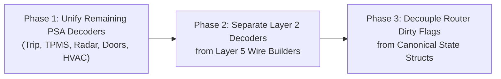

# Task 3 Plan: PSA Profile & Router Architecture Refactoring

## Objective
Eliminate the remaining split decoder logic between [profile_psa.c](file:///home/Fazer/git/canbox-core/src/profiles/profile_psa.c) and [peugeot_407.c](file:///home/Fazer/git/canbox-core/src/profiles/peugeot_407.c), strictly decouple Layer 2 (CAN decoding) from Layer 5 (Hiworld/Raise serial wire builders), and remove embedded `.updated` dirty flags from `memcmp`-compared state structs in [can_router.h](file:///home/Fazer/git/canbox-core/include/core/can_router.h).

---

## Current Bottlenecks
1. **Split Non-RD4 Decoders (`profile_psa.c` vs `peugeot_407.c`):**
   - While RD4 (`0x165`, `0x225`, etc.) now routes through a single `psa_rd4_decode_frame()`, other subsystems (**Trip** `0x221`/`0x2A1`/`0x261`, **TPMS** `0x361`/`0x3A1`/`0x1E1`, **Radar** `0x0E1`, **Doors** `0x220`) still have duplicate decoding logic in `profile_psa.c` (operating on `vehicle_state_t`) and `peugeot_407.c` (operating on legacy standalone `psa_trip_ctx_t`, `psa_tpms_ctx_t`, `psa_radar_ctx_t`, `psa_doors_ctx_t` structs used only by unit tests).
2. **Layer 2 / Layer 5 Monolith (`peugeot_407.c` = 1,370 lines):**
   - `peugeot_407.c` mixes Layer 2 CAN bitfield unpacking (`psa_*_process_can_*`) with Layer 5 Hiworld (`build_hiworld_*`) and Raise (`build_raise_*`) wire frame serialization.
3. **Dirty Flags Inside `memcmp` Structs (`can_router.h` / `can_router.c`):**
   - `vehicle_radio_t`, `vehicle_cdc_t`, `vehicle_audio_settings_t`, and `vehicle_radar_t` embed `bool updated;` inside the struct that `can_router.c` compares via `memcmp(&s_current_state.X, &s_last_sent_state.X, sizeof(...))`. Forgetting to clear `updated = false` before `memcmp` causes false-positive dispatches.

---

## Phased Execution Plan

### Phase 1: Unify Remaining PSA Subsystem Decoders into Canonical `vehicle_state_t`
Consolidate the remaining duplicated decoders so both unit tests and `s_psa_rules[]` in [profile_psa.c](file:///home/Fazer/git/canbox-core/src/profiles/profile_psa.c) call the exact same functions operating on `vehicle_state_t` sub-structs:

1. **Radar (`0x0E1`):**
   - Unify `psa_decode_radar_0x0e1_profile()` ([profile_psa.c](file:///home/Fazer/git/canbox-core/src/profiles/profile_psa.c#L338-L374)) and `psa_radar_process_can_0x0e1()` ([peugeot_407.c](file:///home/Fazer/git/canbox-core/src/profiles/peugeot_407.c)) into `psa_radar_process_can_0x0e1(vehicle_radar_t *radar, const uint8_t *data, uint8_t dlc)` + `psa_radar_decode_frame(const can_frame_t *frame, vehicle_state_t *state)`.
   - Remove legacy `psa_radar_ctx_t` / `psa_radar_state_t` duplicate struct.
2. **Trip Computer (`0x221`, `0x2A1`, `0x261`):**
   - Unify `psa_decode_trip_*_profile()` ([profile_psa.c](file:///home/Fazer/git/canbox-core/src/profiles/profile_psa.c#L292-L336)) and `psa_trip_process_can_*()` into `psa_trip_decode_frame(const can_frame_t *frame, vehicle_state_t *state)` operating directly on `vehicle_trip_t`.
   - Remove legacy `psa_trip_ctx_t` / `psa_trip_state_t` duplicate struct.
3. **TPMS (`0x361`, `0x3A1`, `0x1E1`):**
   - Unify `psa_decode_tpms_*_profile()` ([profile_psa.c](file:///home/Fazer/git/canbox-core/src/profiles/profile_psa.c#L230-L290)) and `psa_tpms_process_can_*()` into `psa_tpms_decode_frame(const can_frame_t *frame, vehicle_state_t *state)` operating directly on `vehicle_tpms_t`.
   - Remove legacy `psa_tpms_ctx_t` / `psa_tpms_state_t` duplicate struct.
4. **Doors (`0x220`) & HVAC (`0x1D0`, `0x1E3`):**
   - Route `0x220`, `0x1D0`, and `0x1E3` directly to `psa_doors_decode_frame()` and `psa_hvac_decode_frame()`.
   - Remove legacy `psa_doors_ctx_t` / `psa_doors_state_t` duplicate struct.
5. **Result for `profile_psa.c`:**
   - Shrinks from ~480 lines to ~150 lines: a pure declarative routing table (`s_psa_rules[]`) plus `0x036`/`0x0F6` power/ignition synthesis.

---

### Phase 2: Decouple Layer 2 (CAN Decoders) from Layer 5 (Protocol Wire Builders)
Enforce the 5-Layer Architecture rule in [AGENTS.md](file:///home/Fazer/git/canbox-core/AGENTS.md#L125-L130):

1. **Extract Hiworld Wire Builders:**
   - Move `build_hiworld_*` functions (`build_hiworld_radio_state`, `build_hiworld_radio_text`, `build_hiworld_radio_preset_*`, `build_hiworld_media_state`, `build_hiworld_audio_settings`, `build_hiworld_radar`, `build_hiworld_trip_*`, `build_hiworld_tpms_*`, `build_hiworld_alert_*`) out of [peugeot_407.c](file:///home/Fazer/git/canbox-core/src/profiles/peugeot_407.c) into [proto_hiworld_adapter.c](file:///home/Fazer/git/canbox-core/src/protocols/proto_hiworld_adapter.c) (or `src/protocols/hiworld_psa_builders.c`).
2. **Prune Unused Legacy Raise Builders in `peugeot_407.c`:**
   - Move or isolate legacy `build_raise_*` helpers out of `peugeot_407.c` so `src/profiles/peugeot_407.c` contains **100% pure PSA CAN2004 decoding logic** (~600 lines instead of ~1,370 lines).

---

### Phase 3: Separate Router Dirty Flags from Canonical Data Structs
Make delta detection in [can_router.c](file:///home/Fazer/git/canbox-core/src/core/can_router.c) uniform and immune to flag-comparison bugs:

1. **Clean Data Structs in [can_router.h](file:///home/Fazer/git/canbox-core/include/core/can_router.h):**
   - Keep `vehicle_radio_t`, `vehicle_cdc_t`, `vehicle_audio_settings_t`, `vehicle_radar_t`, and `vehicle_alerts_t` as pure data structures (no transient `updated`, `preset_updated`, or `radio_text_updated` fields inside the `memcmp` target).
2. **Dedicated Dirty Bitmask / Struct in `vehicle_state_t`:**
   - Group transient event flags into a single `vehicle_dirty_flags_t dirty;` field on `vehicle_state_t` (or compare sub-structs directly via `memcmp` in `can_router_process_can()`), eliminating manual `updated = false` resets before `memcmp`.

---

## Verification Gate (Per Phase)
After each phase:
1. `~/.platformio/penv/bin/pio test -e native_test_runner` (All unit tests pass)
2. `~/.platformio/penv/bin/pio test -e integration_test` (All integration tests pass)
3. `~/.platformio/penv/bin/pio run -e stm32_cbox` & `esp32_cbox` (Zero warnings under `-Wall -Wextra -Werror`)
